# Eletroposto · fluxos do app

Documentação de todos os fluxos do app de recarga, gerada em 02/10/2026 a partir do canvas de design (versão 127) e do mapa de fluxos no FigJam (seções 1 a 28). São 28 fluxos e 208 telas.

## Como esta pasta está organizada

| Pasta ou arquivo | O que tem |
|---|---|
| `telas/` | Cada tela em PNG, a 2x (780 px de largura). |
| `html/` | Cada tela em HTML estático e independente (390 px de largura), para animar. |
| `assets/` | Imagens usadas pelas telas (webp). Os HTML apontam para `../assets/`. |
| `dados/fluxos.json` | A mesma estrutura deste documento em JSON: fluxos, telas, arquivos e caminhos. |
| `index.html` | Galeria para navegar por todas as telas no navegador. |
| `CLAUDE.md` | Instruções para o Claude Code usar esta pasta nas animações. |

**Numeração:** `NN-MM-NomeDoQuadro`. `NN` é o número do fluxo (igual ao FigJam) e `MM` é a ordem da tela dentro do fluxo. O mesmo id vale para o PNG, o HTML e o JSON. Exemplo: `06-02-PagCarregando` é a 2ª tela do fluxo 6 (Recarga).

## O produto em um minuto

O **Eletroposto** é o app de recarga de carro elétrico da iGreen. A pessoa cadastra o carro uma vez, encontra o carregador livre mais perto, paga pelo app (saldo pré-pago via Pix ou cartão de crédito) e acompanha a recarga até o fim, com recibo, cashback e suporte.

O caminho principal de uma recarga é:

1. **Home** → toca no mapa, no posto mais perto ou no atalho "Recarregar de novo".
2. **Mapa e posto** → escolhe o posto e o carregador (ou lê o QR do carregador no local).
3. **Pagamento** → confere quanto carregar (valor, energia, % ou até encher) e como pagar, e toca em **Iniciar recarga**.
4. **Recarga** → o carregador é liberado, a pessoa conecta o cabo em até 1 minuto e acompanha a carga.
5. **Fim** → a recarga para no limite escolhido, com a bateria cheia ou quando a pessoa encerra. A sobra volta para o saldo e o recibo mostra energia, taxa e cashback.

## Regras gerais

- **Recarga pré-paga, cobrança pelo que entrou.** Em qualquer modo (valor, kWh, % ou até encher) a pessoa paga só a energia entregue. O que sobrar da reserva volta na hora para o saldo.
- **Preço = energia × preço do kWh + taxa de início.** Nos exemplos: R$ 1,89/kWh + R$ 2,50 de início (Estação Paulista, C-01). Cada operador define o próprio preço, mostrado antes de iniciar.
- **Duas formas de pagar.** Saldo da carteira, que é colocado via Pix e não tem reserva. Ou cartão de crédito, que reserva R$ 100,00 no limite ao iniciar, cobra no fim só o que foi usado e libera a diferença. A forma escolhida fica salva e pode ser trocada em "Trocar" antes de iniciar.
- **Pix.** Cai na hora, sem taxa. O código copia e cola vale 15 minutos. Se o saldo não cobre a recarga, o app pede só a diferença e a recarga começa sozinha quando o Pix cair. Para pagar com saldo, o mínimo é R$ 10,00.
- **Cabo em até 1 minuto.** Depois de liberado, o carregador espera o cabo por 1 minuto. Se não conectar, nada é cobrado e a reserva volta.
- **Falha não é cobrada.** Se o carregador falha, a pessoa paga só a energia recebida e a taxa de início é estornada. Se o cabo é desconectado no meio, paga a energia entregue e pode reportar "não fui eu".
- **Pendência bloqueia nova recarga.** Se o cartão recusa a cobrança final, a recarga vira pendência e é preciso quitar (Pix ou outro cartão) antes de começar outra.
- **Cashback só para recargas.** Não pode ser sacado nem transferido, vale por 60 dias e o que vence antes é usado primeiro. Nos recibos aparece como 5% da recarga.
- **Compatibilidade pelo modelo do carro.** Marca e modelo definem os conectores aceitos (ex.: CCS2 e Tipo 2), a bateria e a potência máxima. O mapa e o QR mostram só o que encaixa e estimam custo e tempo.
- **Carregador AC não informa a %.** Nesses carregadores a tela mostra os kWh entregues, e a carga da bateria fica no painel do carro.
- **Recarga em andamento não depende do celular.** Sem internet, com sessão expirada ou com a conta bloqueada, a recarga que já começou vai até o fim.
- **Status com o mesmo padrão visual.** Telas de sucesso, aviso e erro usam o "padrão V3": aura em mesh radial no topo, selo de vidro com anéis e o aviso preso ao rodapé do card.

## Dados de exemplo nas telas

Pessoa dos exemplos: **Rafael Moura** (CPF `***.471.946-**`, rafael.moura@email.com, celular `(11) 9****-5000`). Carro principal: **BYD Dolphin Mini** (placa RMA-2E41, CCS2 até 40 kW, Tipo 2 até 6,6 kW, bateria de 38 kWh). Posto de referência: **Estação Paulista** (Av. Paulista, 1842 · 1,2 km), carregadores C-01 a C-04. Saldo de exemplo: R$ 92,00, com R$ 18,50 de cashback.

## Mapa dos fluxos

Como os fluxos se ligam (pelas saídas e entradas de cada seção no FigJam):

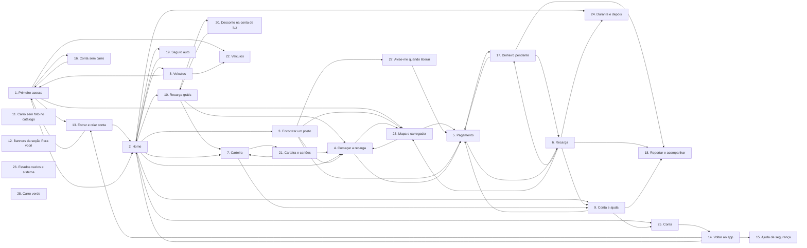

## Índice

- [01 · Primeiro acesso](#01-primeiro-acesso) (10 telas)
- [02 · Home](#02-home) (5 telas)
- [03 · Encontrar um posto](#03-encontrar-um-posto) (12 telas)
- [04 · Começar a recarga](#04-começar-a-recarga) (10 telas)
- [05 · Pagamento](#05-pagamento) (9 telas)
- [06 · Recarga](#06-recarga) (14 telas)
- [07 · Carteira](#07-carteira) (8 telas)
- [08 · Veículos](#08-veículos) (2 telas)
- [09 · Conta e ajuda](#09-conta-e-ajuda) (5 telas)
- [10 · Recarga grátis](#10-recarga-grátis) (3 telas)
- [11 · Carro sem foto no catálogo](#11-carro-sem-foto-no-catálogo) (9 telas)
- [12 · Banners da seção Para você](#12-banners-da-seção-para-você) (21 telas)
- [13 · Entrar e criar conta](#13-entrar-e-criar-conta) (13 telas)
- [14 · Voltar ao app](#14-voltar-ao-app) (10 telas)
- [15 · Ajuda de segurança](#15-ajuda-de-segurança) (4 telas)
- [16 · Conta sem carro](#16-conta-sem-carro) (1 telas)
- [17 · Dinheiro pendente](#17-dinheiro-pendente) (6 telas)
- [18 · Reportar e acompanhar](#18-reportar-e-acompanhar) (6 telas)
- [19 · Seguro auto](#19-seguro-auto) (6 telas)
- [20 · Desconto na conta de luz](#20-desconto-na-conta-de-luz) (3 telas)
- [21 · Carteira e cartões](#21-carteira-e-cartões) (6 telas)
- [22 · Veículos](#22-veículos) (4 telas)
- [23 · Mapa e carregador](#23-mapa-e-carregador) (6 telas)
- [24 · Durante e depois](#24-durante-e-depois) (5 telas)
- [25 · Conta](#25-conta) (8 telas)
- [26 · Estados vazios e sistema](#26-estados-vazios-e-sistema) (6 telas)
- [27 · Avise-me quando liberar](#27-avise-me-quando-liberar) (10 telas)
- [28 · Carro verde](#28-carro-verde) (6 telas)

## Pontos em aberto

- A home base (HomeV04Completa e as telas derivadas dela) mostra o carro como **BYD King**, enquanto o resto dos fluxos usa o **BYD Dolphin Mini**.
- O cashback das ofertas aparece com dois valores: **R$ 100** em Ofertas, Ativar energia e Cashback concedido, e **R$ 10** nos banners, na carteira e no seguro. Falta definir o valor oficial.
- A tela **Primeiro acesso 3** ainda tem o botão "Só quero dar uma olhada", mas o acesso de visitante foi descartado.
- A seção 12 (banners) e a 28 (carro verde) são testes de design. O banner P13 compacto da seção 28 existe só nas duas homes dessa seção.

---

## 01 Primeiro acesso

_Boas-vindas, permissões e cadastro do carro_

**O que acontece.** Três telas de boas-vindas explicam a proposta: cadastrar o carro uma vez, pagar com Pix sem surpresa e achar o carregador livre mais perto. "Começar agora" (ou "Pular") leva à identificação da conta (fluxo 13) e, na volta, o app pede localização e notificações e cadastra o carro. A pessoa escolhe marca e modelo num catálogo, digita a placa e confirma. O app mostra o que descobriu pelo modelo: conectores, bateria e potência máxima.

**Regras**

- Localização só com o app aberto, nunca em segundo plano. "Agora não" não bloqueia nada.
- Notificações são opcionais e servem para avisar carregador liberado, bateria no limite e recarga que parou.
- O modelo define conectores, bateria e potência. Esses dados filtram o mapa e estimam custo e tempo.
- Carro de aplicativo (Uber, 99) e veículo principal são marcados no cadastro. O principal aparece na home e já vem escolhido na recarga.
- A ficha do modelo (sheet) mostra as potências máximas AC/DC e a bateria, e leva ao mapa de eletropostos compatíveis (fluxo 23).

**Sai para:** _2. Home_

**Telas**

| Nº | Tela | Prévia | Arquivos |
|---|---|---|---|
| 01-01 | **BoasVindas1** Primeiro acesso 1 · Cadastre seu carro | 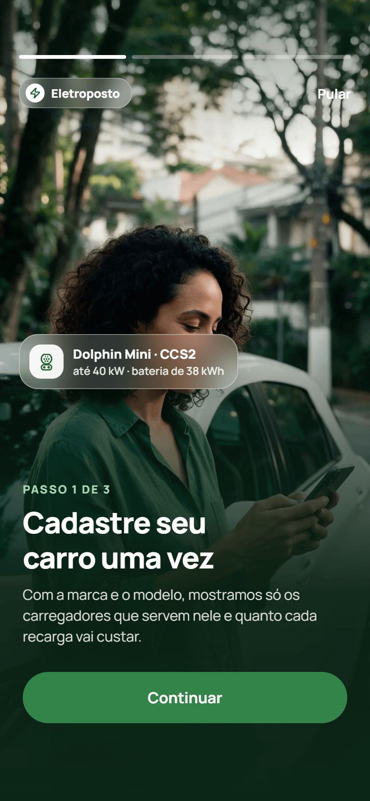 | [PNG](telas/01-01-BoasVindas1.png) · [HTML](html/01-01-BoasVindas1.html) |
| 01-02 | **BoasVindas2** Primeiro acesso 2 · Pague com Pix | 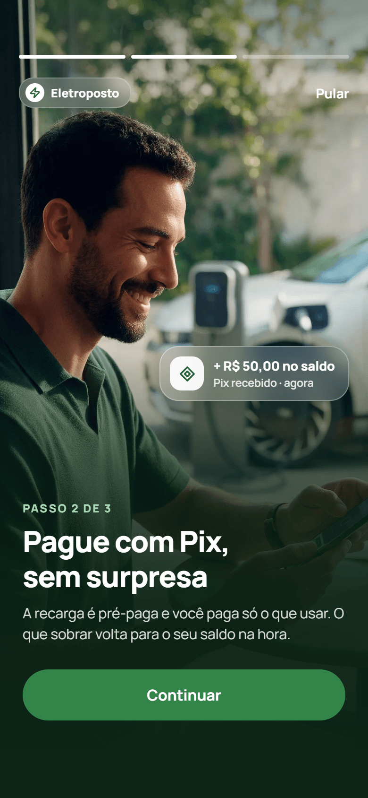 | [PNG](telas/01-02-BoasVindas2.png) · [HTML](html/01-02-BoasVindas2.html) |
| 01-03 | **BoasVindas3** Primeiro acesso 3 · Carregador livre por perto | 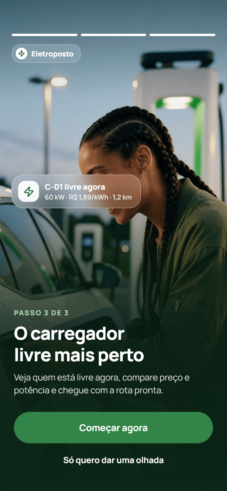 | [PNG](telas/01-03-BoasVindas3.png) · [HTML](html/01-03-BoasVindas3.html) |
| 01-04 | **PermLocal** Primeiro acesso 4 · Permissão de localização | 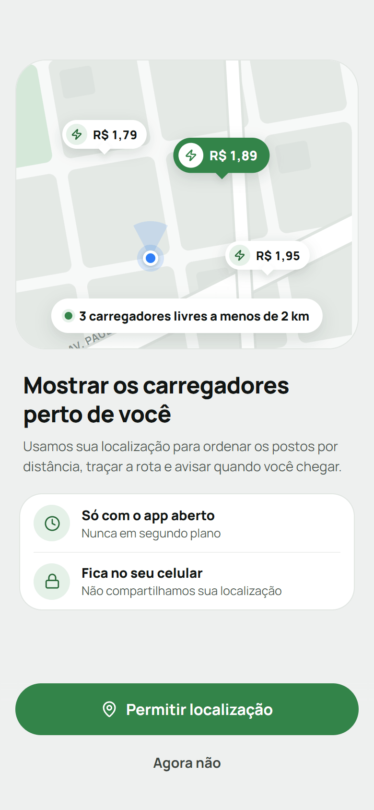 | [PNG](telas/01-04-PermLocal.png) · [HTML](html/01-04-PermLocal.html) |
| 01-05 | **PermNotificacoes** Primeiro acesso 5 · Permissão de notificações | 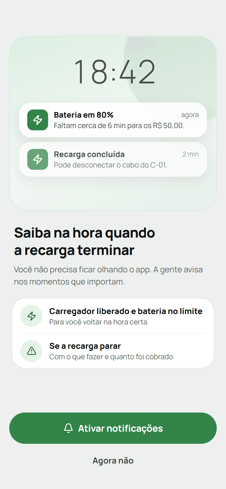 | [PNG](telas/01-05-PermNotificacoes.png) · [HTML](html/01-05-PermNotificacoes.html) |
| 01-06 | **VeiculoNovoVazio** Novo veículo · vazio | 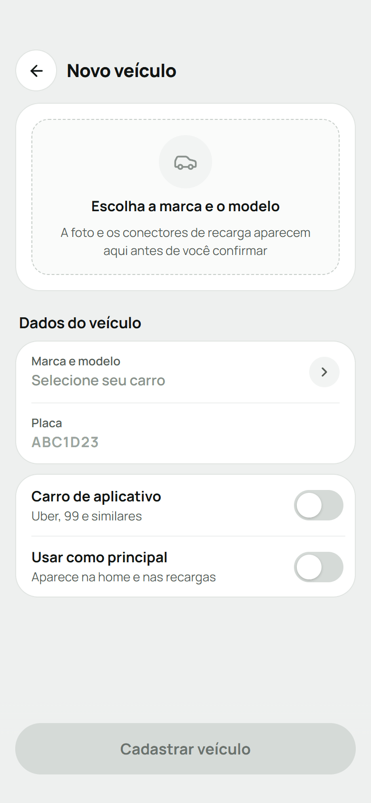 | [PNG](telas/01-06-VeiculoNovoVazio.png) · [HTML](html/01-06-VeiculoNovoVazio.html) |
| 01-07 | **VeiculoEscolherModelo** Novo veículo · escolher modelo | 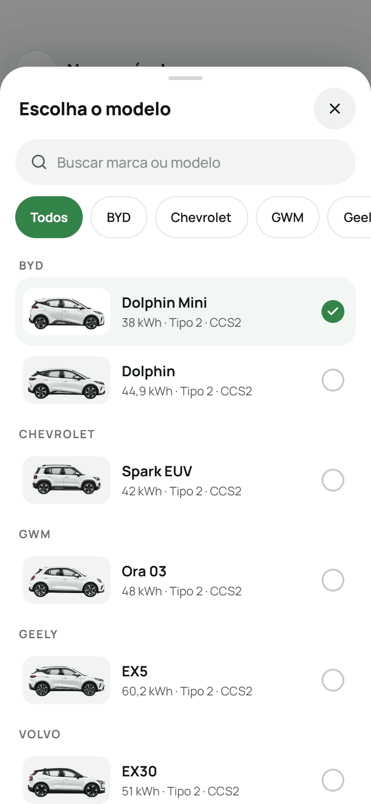 | [PNG](telas/01-07-VeiculoEscolherModelo.png) · [HTML](html/01-07-VeiculoEscolherModelo.html) |
| 01-08 | **VeiculoNovoPreenchido** Novo veículo · preenchido (definitivo) | 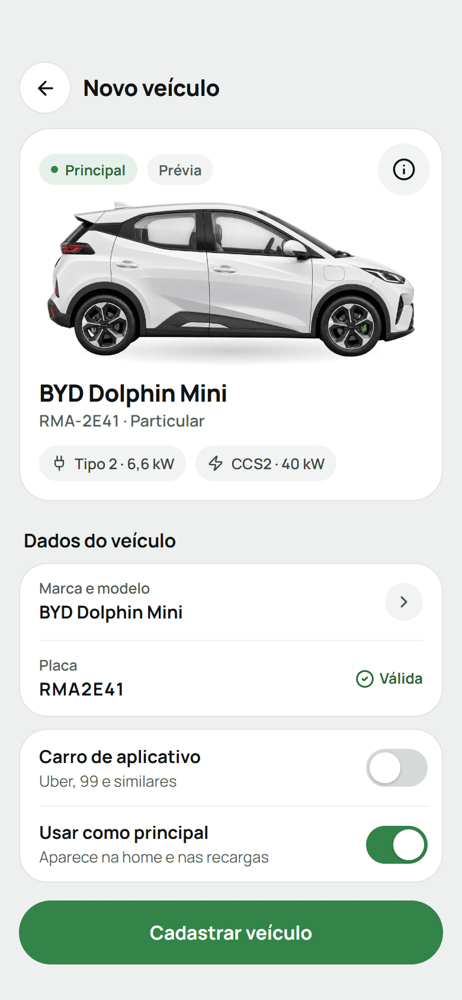 | [PNG](telas/01-08-VeiculoNovoPreenchido.png) · [HTML](html/01-08-VeiculoNovoPreenchido.html) |
| 01-09 | **VeiculoOk** Primeiro acesso 6 · Veículo cadastrado | 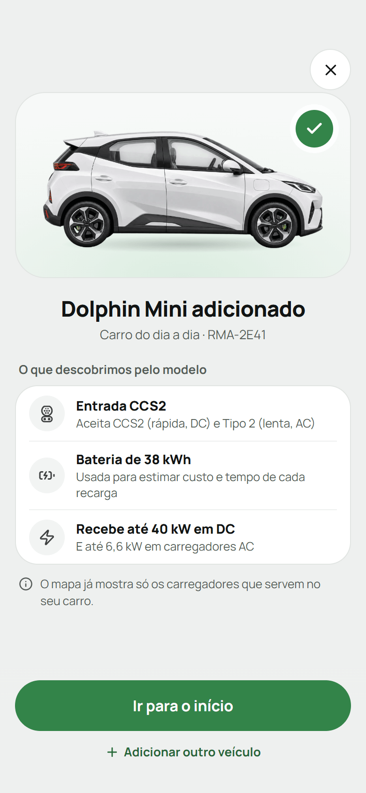 | [PNG](telas/01-09-VeiculoOk.png) · [HTML](html/01-09-VeiculoOk.html) |
| 01-10 | **VeiculoFichaSheet** Novo veículo · dados de recarga (sheet do botão ⓘ) | 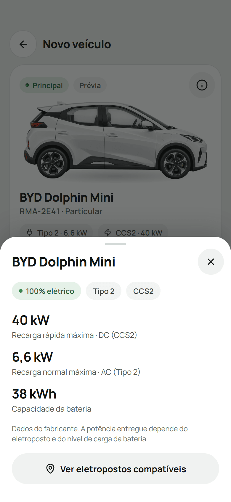 | [PNG](telas/01-10-VeiculoFichaSheet.png) · [HTML](html/01-10-VeiculoFichaSheet.html) |

**Caminhos** (de → para: o que dispara)

- **01-01** BoasVindas1 → **01-02** BoasVindas2: Continuar
- **01-02** BoasVindas2 → **01-03** BoasVindas3: Continuar
- **01-01** BoasVindas1 → **01-04** PermLocal: Pular · entra pela 13. Entrar e criar conta
- **01-03** BoasVindas3 → **01-04** PermLocal: Começar agora · entra pela 13. Entrar e criar conta
- **01-04** PermLocal → **01-05** PermNotificacoes: Permitir ou Agora não
- **01-05** PermNotificacoes → **01-06** VeiculoNovoVazio: Ativar ou Agora não
- **01-06** VeiculoNovoVazio → **01-07** VeiculoEscolherModelo: Marca e modelo
- **01-07** VeiculoEscolherModelo → **01-08** VeiculoNovoPreenchido: Escolhe o modelo
- **01-08** VeiculoNovoPreenchido → **01-09** VeiculoOk: Cadastrar veículo
- **01-08** VeiculoNovoPreenchido → **01-10** VeiculoFichaSheet: Ver dados de recarga do modelo
- **01-09** VeiculoOk → _→ 2. Home_: Ir para o início

---

## 02 Home

_Ponto de partida: veículo, saldo, serviços e o posto mais perto_

**O que acontece.** A home é o ponto de partida. Ela mostra o veículo principal com foto, placa e conector, o saldo com o botão Adicionar, "Meus serviços" (Mapa, QR Code, Recargas, Saldo, Veículos, Pontos e Configurações, mais um sheet com todos), o posto mais perto com rota e "Carregar aqui", o carrossel "Para você" com ofertas, o "Meu resumo" do mês e a central de ajuda. Daqui saem quase todos os outros fluxos.

**Regras**

- Sem conexão, a tela avisa e oferece "Tentar de novo". Recargas em andamento continuam normalmente.
- Sem posto num raio de 10 km, o card do posto vira um convite para explorar o mapa.
- Com uma recarga rodando, a home troca o card do carro pelo progresso da carga (fluxo 6, HomeAtiva).

**Sai para:** _3. Encontrar um posto · Mapa · Mais próximo de você_ · _4. Começar a recarga · QR Code · Recarregar de novo_ · _7. Carteira · Saldo · Adicionar · Recargas_ · _8. Veículos · Trocar veículo · Veículos_ · _9. Conta e ajuda · Central de ajuda · Configurações_ · _10. Recarga grátis · Banner Para você_

**Telas**

| Nº | Tela | Prévia | Arquivos |
|---|---|---|---|
| 02-01 | **Carregando** Estados · Carregando a home (esqueleto) | 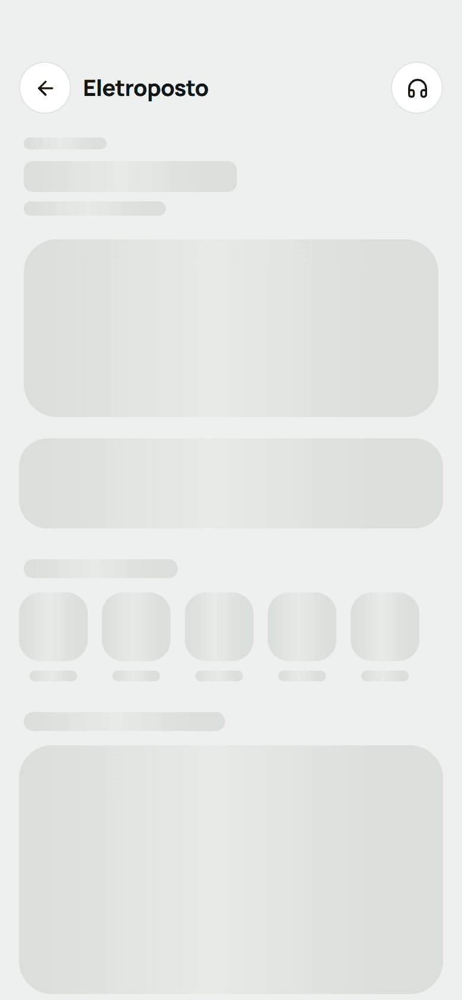 | [PNG](telas/02-01-Carregando.png) · [HTML](html/02-01-Carregando.html) |
| 02-02 | **HomeV04Completa** Home completa · base V04 (Seu veículo) | 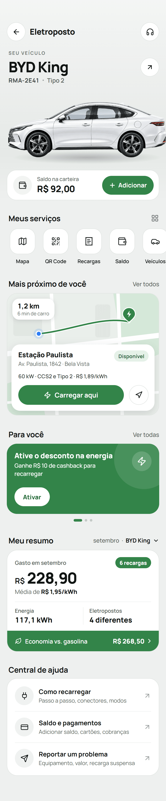 | [PNG](telas/02-02-HomeV04Completa.png) · [HTML](html/02-02-HomeV04Completa.html) |
| 02-03 | **HomeServicosSheet** Todos os serviços (ao tocar na grade) | 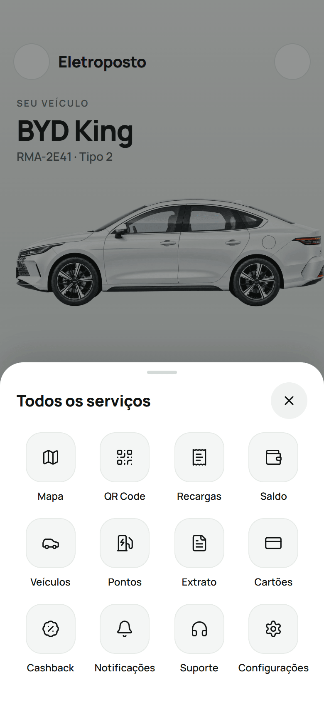 | [PNG](telas/02-03-HomeServicosSheet.png) · [HTML](html/02-03-HomeServicosSheet.html) |
| 02-04 | **ErroRede** Estados · Sem conexão (padrão das telas) Estados da home | 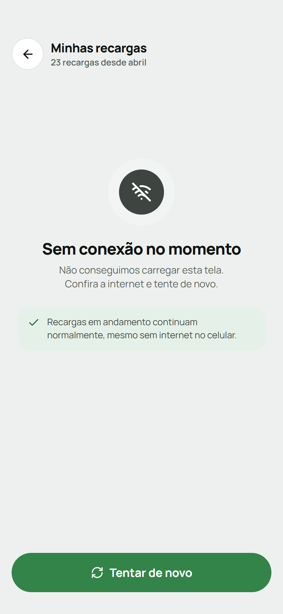 | [PNG](telas/02-04-ErroRede.png) · [HTML](html/02-04-ErroRede.html) |
| 02-05 | **HomeSemPosto** Estados · Home sem posto perto e sem recargas Estados da home | 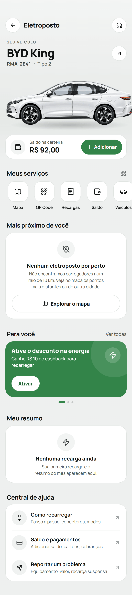 | [PNG](telas/02-05-HomeSemPosto.png) · [HTML](html/02-05-HomeSemPosto.html) |

**Caminhos** (de → para: o que dispara)

- **02-01** Carregando → **02-02** HomeV04Completa: Dados carregados
- **02-02** HomeV04Completa → **02-03** HomeServicosSheet: Ver todos os serviços
- **02-01** Carregando → **02-04** ErroRede: Sem conexão
- **02-02** HomeV04Completa → **02-05** HomeSemPosto: Sem posto perto e sem recargas
- **02-02** HomeV04Completa → _→ 3. Encontrar um posto · Mapa · Mais próximo de você_: Mapa · Mais próximo de você
- **02-02** HomeV04Completa → _→ 4. Começar a recarga · QR Code · Recarregar de novo_: QR Code · Recarregar de novo
- **02-02** HomeV04Completa → _→ 7. Carteira · Saldo · Adicionar · Recargas_: Saldo · Adicionar · Recargas
- **02-02** HomeV04Completa → _→ 8. Veículos · Trocar veículo · Veículos_: Trocar veículo · Veículos
- **02-02** HomeV04Completa → _→ 9. Conta e ajuda · Central de ajuda · Configurações_: Central de ajuda · Configurações
- **02-02** HomeV04Completa → _→ 10. Recarga grátis · Banner Para você_: Banner Para você

---

## 03 Encontrar um posto

_Mapa, lista, filtros, detalhe do posto, rota e chegada_

**O que acontece.** O mapa mostra os postos com o preço do kWh e o status (livre ou ocupado), com filtros e um modo lista. O detalhe do posto tem fotos, horário, nota, comodidades, o carro da pessoa e um carrossel de carregadores: livre, ocupado com previsão ("Avisar quando liberar") ou "Não encaixa". A pessoa pode simular o custo, traçar a rota (Google Maps ou Waze) e, ao chegar, recebe instruções de onde estacionar, com as opções de ler o QR ou carregar sem QR.

**Regras**

- Os filtros começam pelos conectores do carro. Também filtram por potência (normal, rápida, ultra), "só disponíveis agora" e comodidades, e ordenam por distância, preço ou potência.
- A calculadora estima por bateria (de X% até Y%) ou por valor: energia × R$/kWh + taxa de início. O valor final depende da recarga real.
- Se o carregador escolhido for ocupado no caminho, o app troca para um equivalente livre no mesmo posto e avisa.
- Se todos os rápidos estiverem ocupados na chegada, o app mostra a previsão de cada um e oferece aviso de vaga (fluxo 27). Ainda não dá para reservar.
- Sem localização, o mapa abre no centro da cidade. Sem resultado, o app sugere ampliar o raio ou limpar os filtros.

**Sai para:** _5. Pagamento_ · _4. Ler o QR_

**Telas**

| Nº | Tela | Prévia | Arquivos |
|---|---|---|---|
| 03-01 | **MapaPostos** Mapa 1 · postos no mapa | 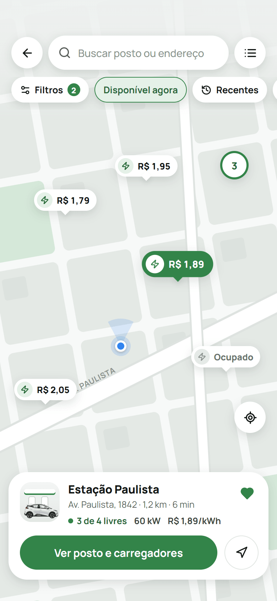 | [PNG](telas/03-01-MapaPostos.png) · [HTML](html/03-01-MapaPostos.html) |
| 03-02 | **MapaPosto** Mapa 5 · detalhe do posto e carregadores | 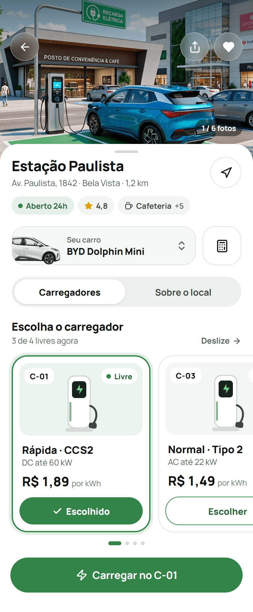 | [PNG](telas/03-02-MapaPosto.png) · [HTML](html/03-02-MapaPosto.html) |
| 03-03 | **MapaRota** Mapa 4 · rota até o posto | 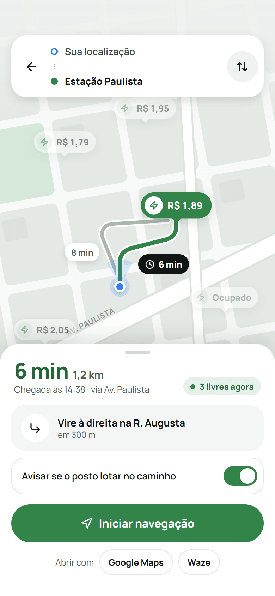 | [PNG](telas/03-03-MapaRota.png) · [HTML](html/03-03-MapaRota.html) |
| 03-04 | **Chegou** Chegada · Você chegou ao posto | 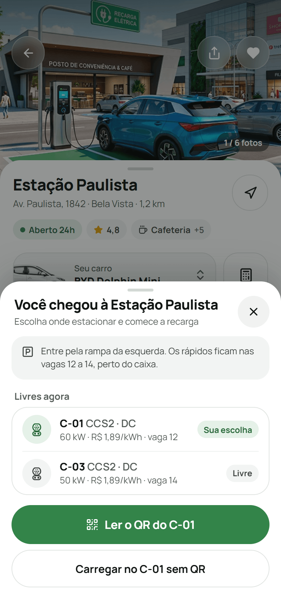 | [PNG](telas/03-04-Chegou.png) · [HTML](html/03-04-Chegou.html) |
| 03-05 | **MapaLista** Mapa 2 · lista (próximos, recentes, favoritos) | 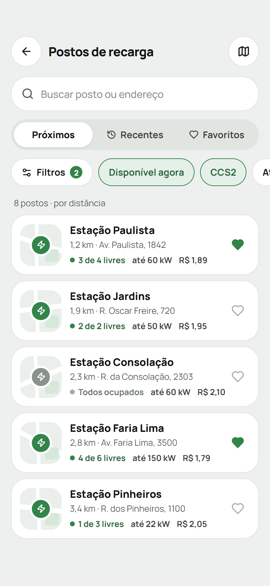 | [PNG](telas/03-05-MapaLista.png) · [HTML](html/03-05-MapaLista.html) |
| 03-06 | **MapaPostoSobre** Mapa 5b · sobre o local (aba do posto) | 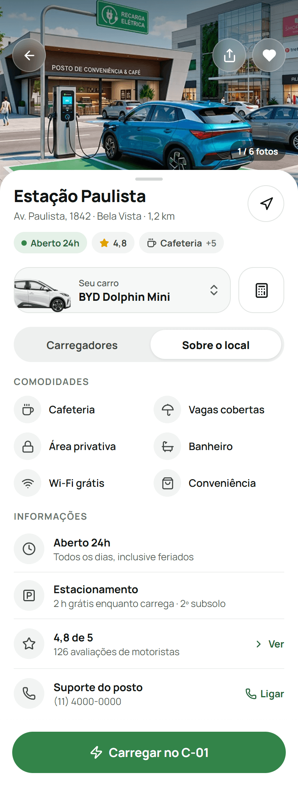 | [PNG](telas/03-06-MapaPostoSobre.png) · [HTML](html/03-06-MapaPostoSobre.html) |
| 03-07 | **ACaminhoOcupado** Chegada · Carregador ocupado no caminho | 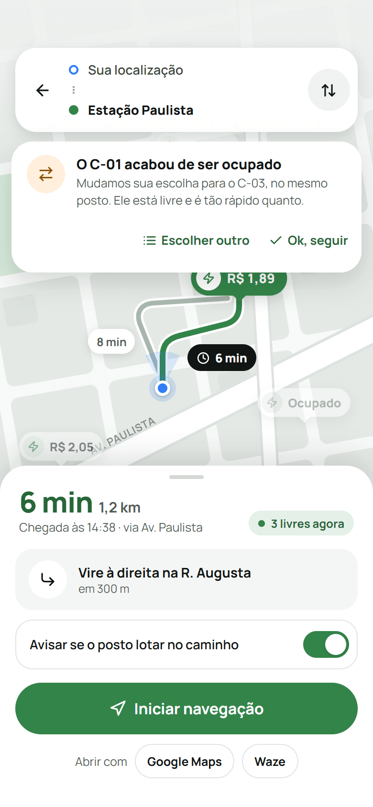 | [PNG](telas/03-07-ACaminhoOcupado.png) · [HTML](html/03-07-ACaminhoOcupado.html) |
| 03-08 | **PostoLotado** Chegada · Posto lotado: avisar quando liberar | 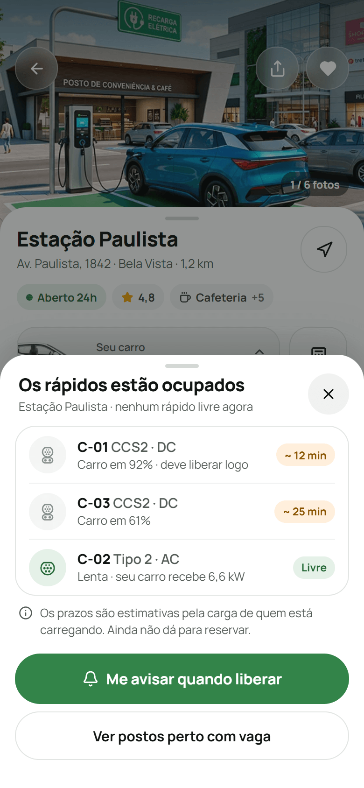 | [PNG](telas/03-08-PostoLotado.png) · [HTML](html/03-08-PostoLotado.html) |
| 03-09 | **MapaFiltros** Mapa 3 · filtros (sheet) Estados do mapa | 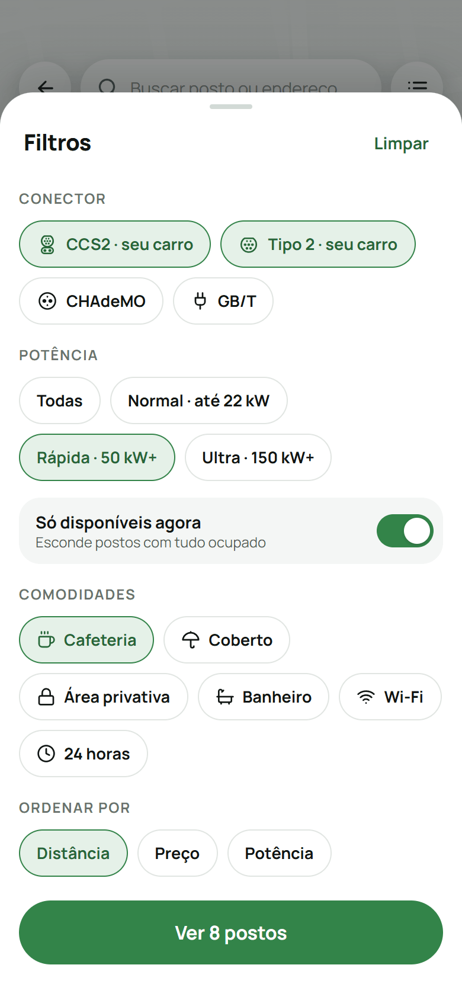 | [PNG](telas/03-09-MapaFiltros.png) · [HTML](html/03-09-MapaFiltros.html) |
| 03-10 | **MapaCalculadora** Mapa 6 · calculadora de valor (sheet) Estados do mapa | 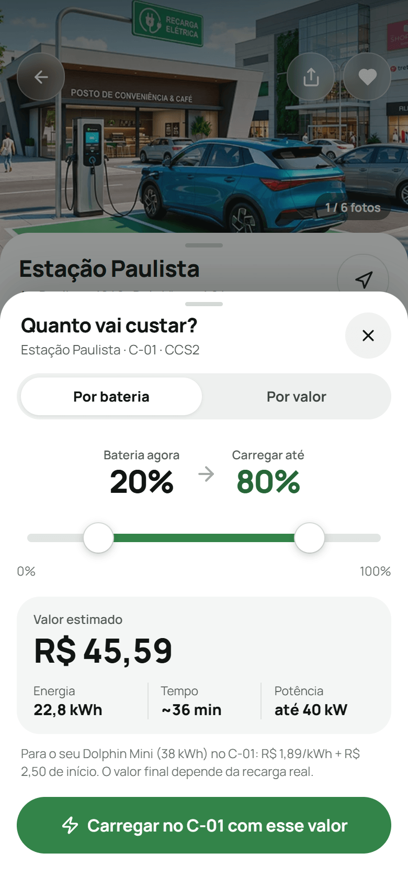 | [PNG](telas/03-10-MapaCalculadora.png) · [HTML](html/03-10-MapaCalculadora.html) |
| 03-11 | **MapaSemLocal** Estados · Mapa sem permissão de localização Estados do mapa | 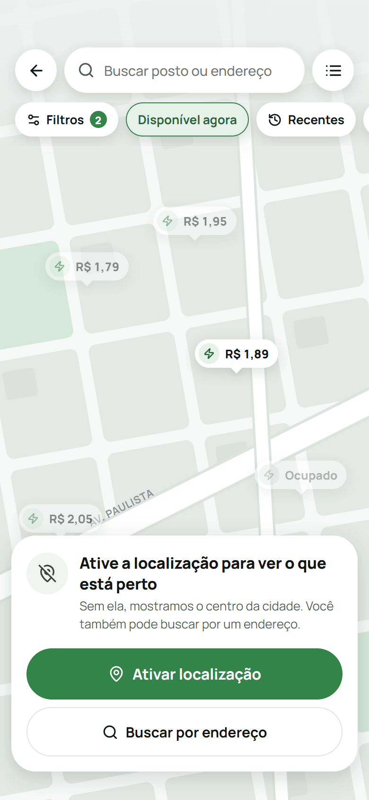 | [PNG](telas/03-11-MapaSemLocal.png) · [HTML](html/03-11-MapaSemLocal.html) |
| 03-12 | **MapaSemResultado** Estados · Mapa sem resultados na área Estados do mapa | 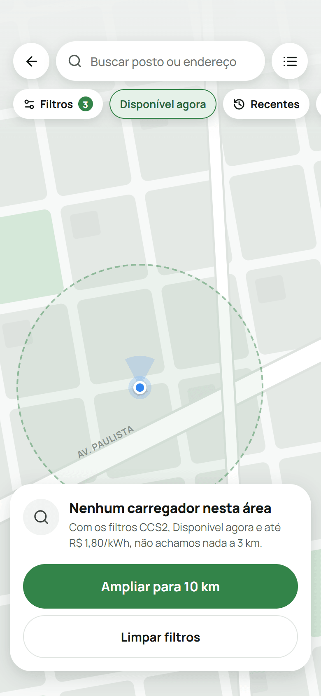 | [PNG](telas/03-12-MapaSemResultado.png) · [HTML](html/03-12-MapaSemResultado.html) |

**Caminhos** (de → para: o que dispara)

- **03-01** MapaPostos → **03-02** MapaPosto: Ver posto e carregadores
- **03-02** MapaPosto → **03-03** MapaRota: Traçar rota até o posto
- **03-03** MapaRota → **03-04** Chegou: Chegou ao posto
- **03-01** MapaPostos → **03-05** MapaLista: Ver em lista
- **03-02** MapaPosto → **03-06** MapaPostoSobre: Aba Sobre o local
- **03-03** MapaRota → **03-07** ACaminhoOcupado: Carregador ocupou no caminho
- **03-04** Chegou → **03-08** PostoLotado: Rápidos ocupados
- **03-05** MapaLista → **03-09** MapaFiltros: Filtros
- **03-06** MapaPostoSobre → **03-10** MapaCalculadora: Simular quanto vai custar
- **03-02** MapaPosto → _→ 5. Pagamento_: Carregar no C-01
- **03-04** Chegou → _→ 4. Ler o QR_: Ler o QR do C-01
- **03-04** Chegou → _→ 5. Pagamento_: Carregar no C-01 sem QR

---

## 04 Começar a recarga

_Atalho da home, leitura do QR, código digitado e conectores_

**O que acontece.** Há três jeitos de começar: o atalho "Recarregar de novo" (mesmo posto, valor e pagamento da última vez), ler o QR do carregador ou digitar o código da etiqueta. Depois da leitura, o app mostra os conectores daquele carregador, com a potência que o carro recebe, o preço e qual encaixa. A pessoa escolhe e segue para o pagamento.

**Regras**

- O atalho só preenche a sheet. Nada é cobrado sem o toque em "Iniciar".
- O código do carregador tem cinco números, um traço e um dígito (ex.: 29837-1).
- Erros da leitura: sem câmera (libera nos Ajustes ou digita), QR não reconhecido (alerta de golpe com adesivo colado por cima), carregador de outra rede (não aceita pagamento pelo app e sugere parceiros) e sem internet (nada foi cobrado).
- Um conector incompatível aparece como "Não encaixa". O sheet "Qual conector escolher?" explica rápido × lento com tempo estimado.

**Sai para:** _5. Pagamento_ · _QR 1 · escolher o conector_

**Telas**

| Nº | Tela | Prévia | Arquivos |
|---|---|---|---|
| 04-01 | **PropAtalhoHome** Proposta 1 · Recarregar de novo (card da home) | 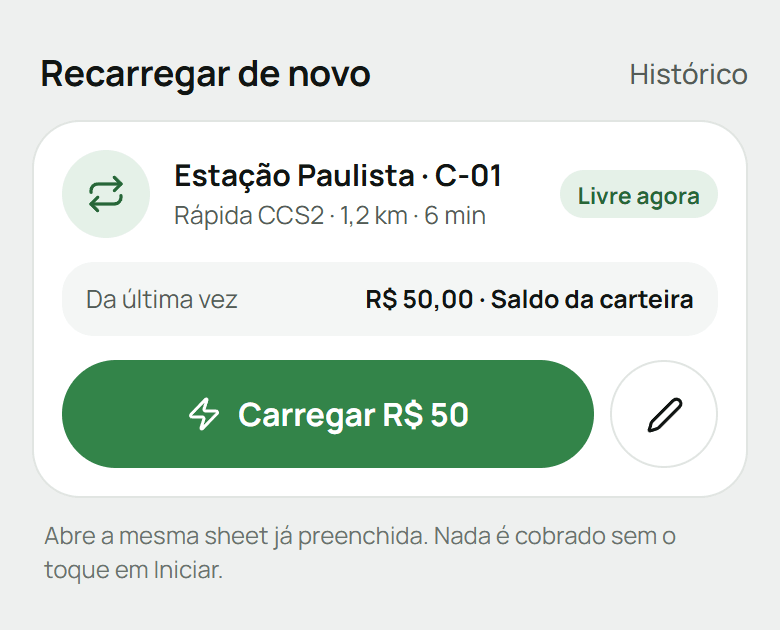 | [PNG](telas/04-01-PropAtalhoHome.png) · [HTML](html/04-01-PropAtalhoHome.html) |
| 04-02 | **PropQR** Proposta 2 · Ler o QR do carregador | 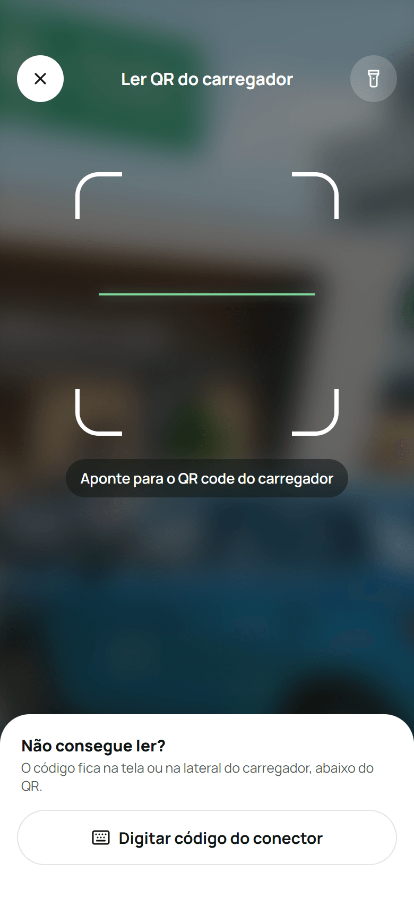 | [PNG](telas/04-02-PropQR.png) · [HTML](html/04-02-PropQR.html) |
| 04-03 | **QrConectores** QR 1 · Carregador encontrado: escolha o conector | 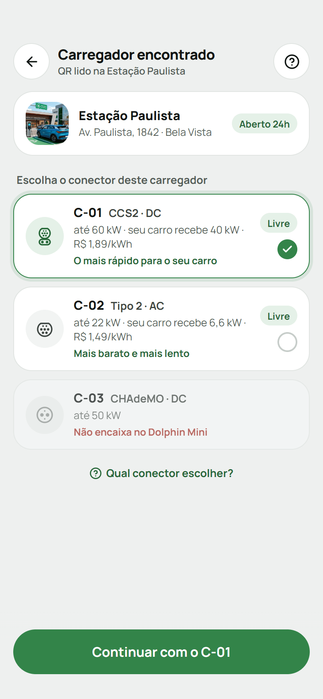 | [PNG](telas/04-03-QrConectores.png) · [HTML](html/04-03-QrConectores.html) |
| 04-04 | **QrQualConector** QR 1b · Qual conector escolher (sheet) | 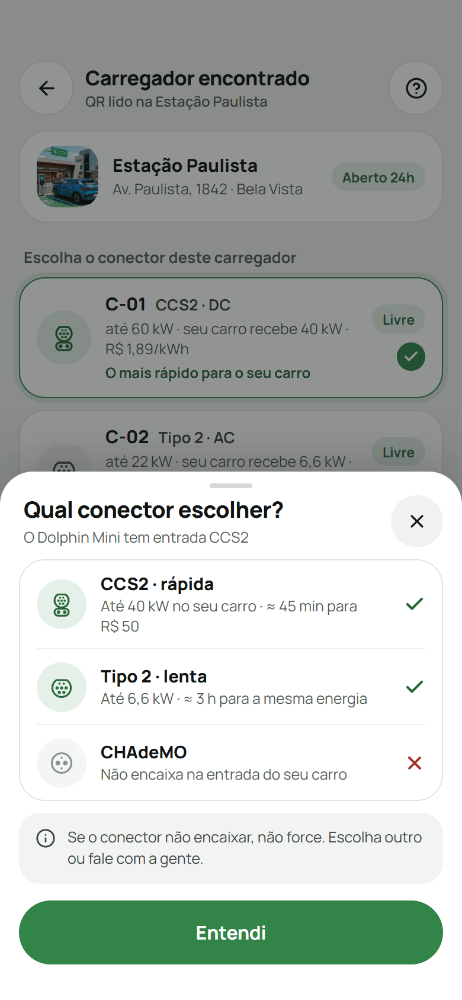 | [PNG](telas/04-04-QrQualConector.png) · [HTML](html/04-04-QrQualConector.html) |
| 04-05 | **QrSemCamera** QR 2 · Sem acesso à câmera Erros da leitura | 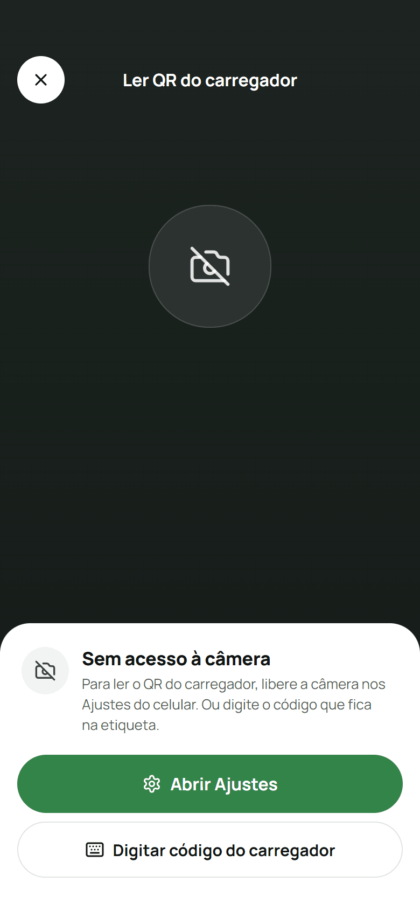 | [PNG](telas/04-05-QrSemCamera.png) · [HTML](html/04-05-QrSemCamera.html) |
| 04-06 | **QrInvalido** QR 3 · Código não reconhecido Erros da leitura | 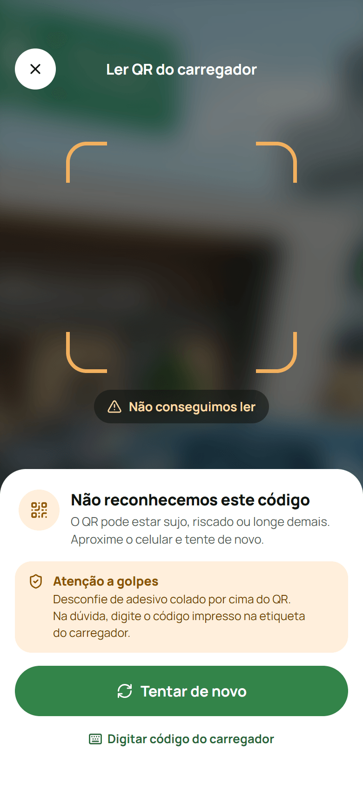 | [PNG](telas/04-06-QrInvalido.png) · [HTML](html/04-06-QrInvalido.html) |
| 04-07 | **QrOutraRede** QR 4 · Carregador de outra rede Erros da leitura | 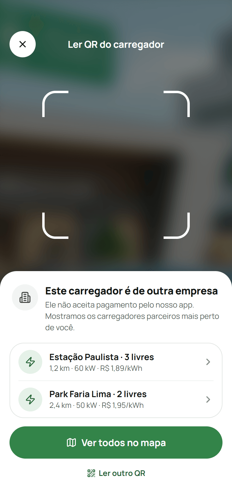 | [PNG](telas/04-07-QrOutraRede.png) · [HTML](html/04-07-QrOutraRede.html) |
| 04-08 | **QrSemInternet** QR 5 · Sem internet Erros da leitura | 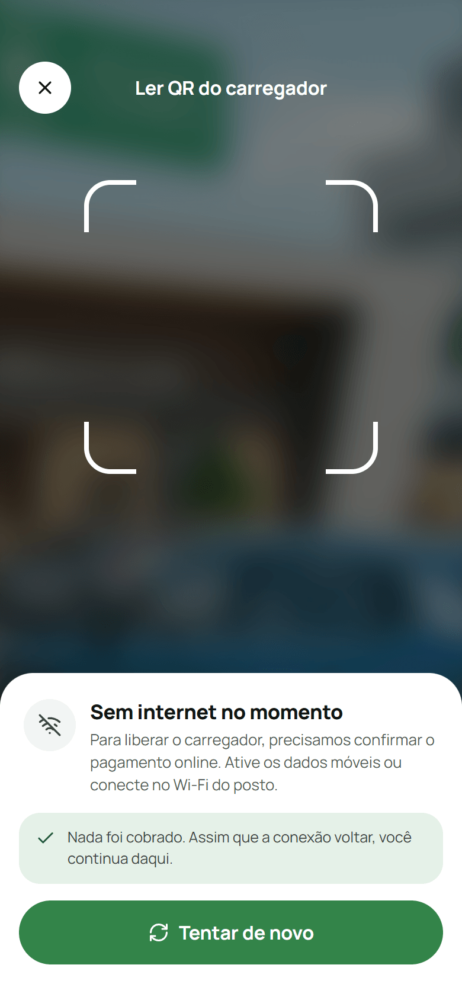 | [PNG](telas/04-08-QrSemInternet.png) · [HTML](html/04-08-QrSemInternet.html) |
| 04-09 | **CodigoDigitar** QR 6 · Digitar código do carregador | 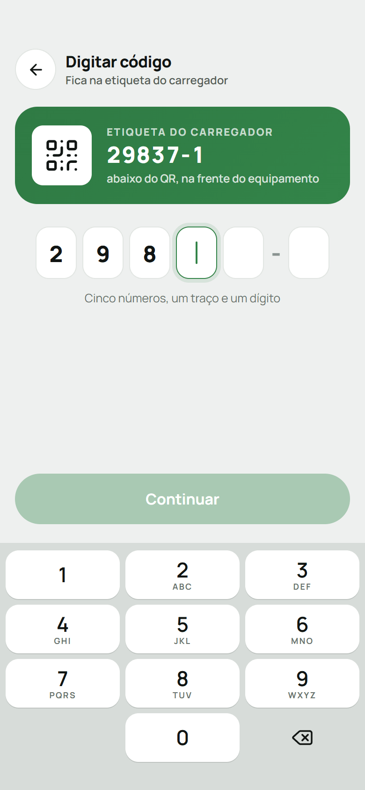 | [PNG](telas/04-09-CodigoDigitar.png) · [HTML](html/04-09-CodigoDigitar.html) |
| 04-10 | **CodigoInvalido** QR 7 · Código não encontrado | 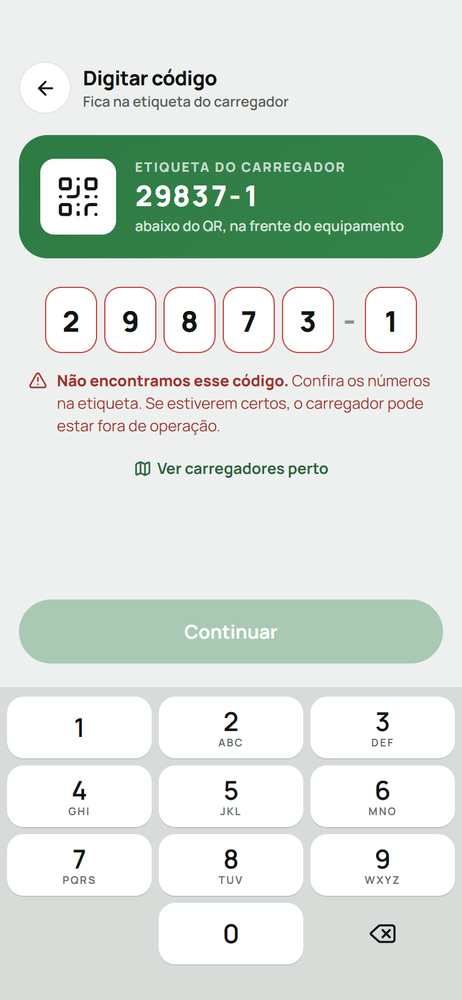 | [PNG](telas/04-10-CodigoInvalido.png) · [HTML](html/04-10-CodigoInvalido.html) |

**Caminhos** (de → para: o que dispara)

- **04-01** PropAtalhoHome → **04-02** PropQR: Carregar R$ 50 ou Escolher outro valor
- **04-02** PropQR → **04-03** QrConectores: QR lido
- **04-03** QrConectores → **04-04** QrQualConector: Qual conector escolher?
- **04-02** PropQR → **04-05** QrSemCamera: Sem acesso à câmera
- **04-02** PropQR → **04-06** QrInvalido: Código não reconhecido
- **04-02** PropQR → **04-07** QrOutraRede: QR de outra rede
- **04-02** PropQR → **04-08** QrSemInternet: Sem internet
- **04-05** QrSemCamera → **04-09** CodigoDigitar: Digitar código do carregador
- **04-09** CodigoDigitar → **04-10** CodigoInvalido: Código não existe
- **04-03** QrConectores → _→ 5. Pagamento_: Continuar com o C-01
- **04-09** CodigoDigitar → _→ QR 1 · escolher o conector_: Código válido

---

## 05 Pagamento

_Como e quanto carregar, forma de pagamento e saldo_

**O que acontece.** Na primeira recarga, a pessoa escolhe como prefere pagar: saldo ou cartão. Depois disso a sheet "Confira e inicie" já vem pronta, com o valor (atalhos R$ 30, 50, 100 ou até encher, ou digitado), a forma de pagamento com "Trocar" e o total estimado em kWh, tempo, preço do kWh e taxa de início. Se o saldo não cobre, o app mostra quanto falta e gera um Pix só da diferença. Quando o Pix cai, a recarga começa sozinha.

**Regras**

- Quatro modos, salvos para a próxima recarga: valor em R$, energia em kWh, porcentagem da bateria (só DC) e até encher.
- Cartão: reserva de R$ 100,00 ao iniciar, cobrança só do que foi usado e liberação do resto. Saldo: sem reserva.
- Saldo insuficiente: "Adicionar R$ 13,60 e iniciar" (só a diferença), outro valor via Pix, ou pagar tudo no cartão.
- O código Pix vale 15 minutos. Se expira, nada é cobrado e o app gera outro com o mesmo valor. Pix pago nos últimos minutos entra sozinho quando o banco confirma.
- Carteira zerada: o mínimo para começar com saldo é R$ 10,00.

**Chega aqui por:** _Carregador e conector escolhidos_

**Sai para:** _6. Recarga_

**Telas**

| Nº | Tela | Prévia | Arquivos |
|---|---|---|---|
| 05-01 | **PropPrimeiraVez** Proposta 3c · Só na primeira recarga: como pagar | 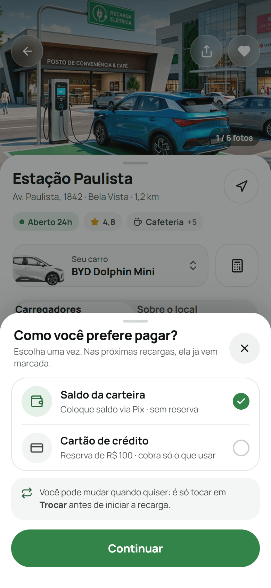 | [PNG](telas/05-01-PropPrimeiraVez.png) · [HTML](html/05-01-PropPrimeiraVez.html) |
| 05-02 | **PropConfira** Proposta 3 · Pagamento: escolha como e quanto carregar | 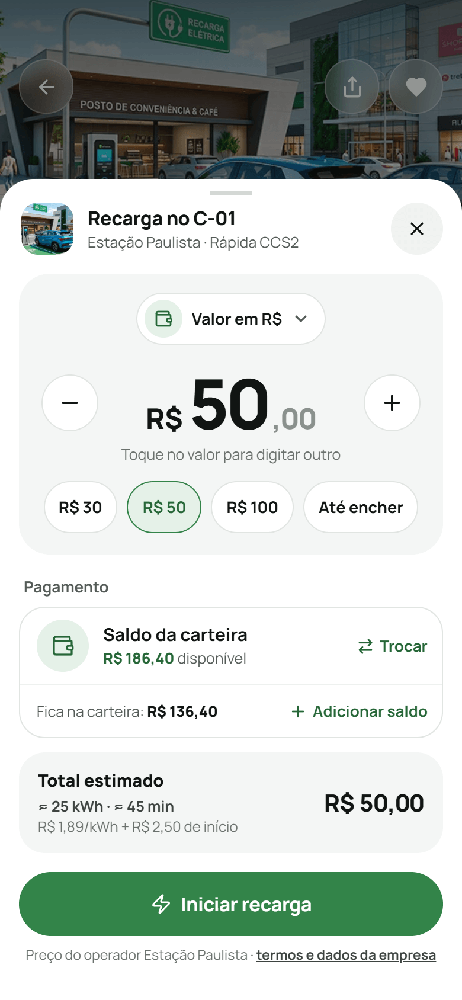 | [PNG](telas/05-02-PropConfira.png) · [HTML](html/05-02-PropConfira.html) |
| 05-03 | **PropSaldoInsuf** Proposta 3b · Mesma sheet quando o saldo não cobre | 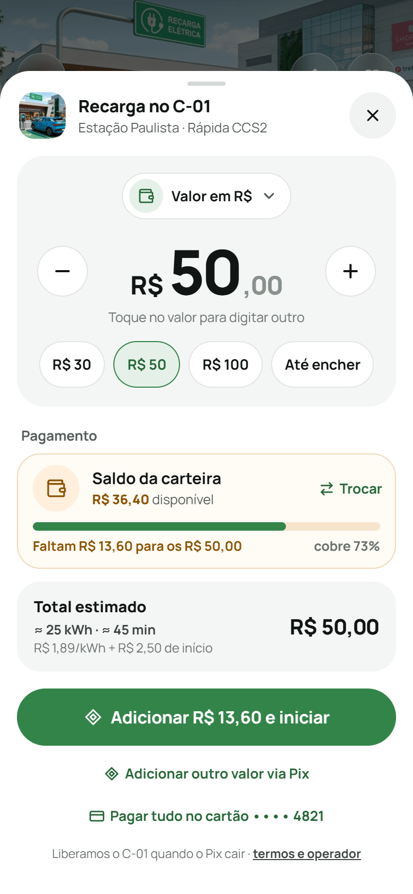 | [PNG](telas/05-03-PropSaldoInsuf.png) · [HTML](html/05-03-PropSaldoInsuf.html) |
| 05-04 | **PropPixRecarga** Proposta 3d · Pix gerado: a recarga começa sozinha | 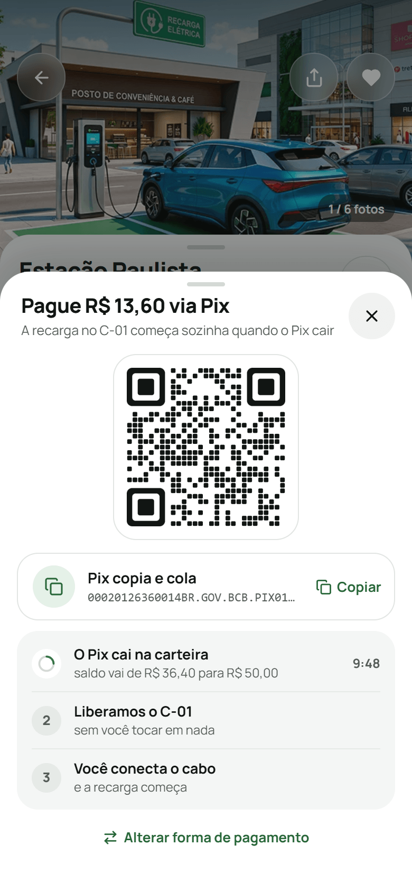 | [PNG](telas/05-04-PropPixRecarga.png) · [HTML](html/05-04-PropPixRecarga.html) |
| 05-05 | **PropModo** Proposta 3e · Como carregar (abre pelo botão do valor) | 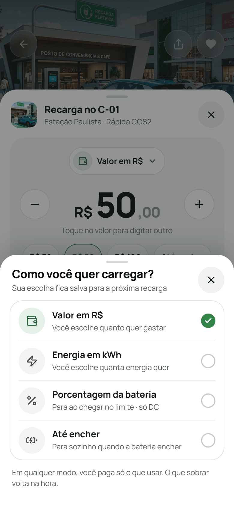 | [PNG](telas/05-05-PropModo.png) · [HTML](html/05-05-PropModo.html) |
| 05-06 | **PagPixSheet** Pagamento 1c · Adicionar saldo: quanto (sheet) | 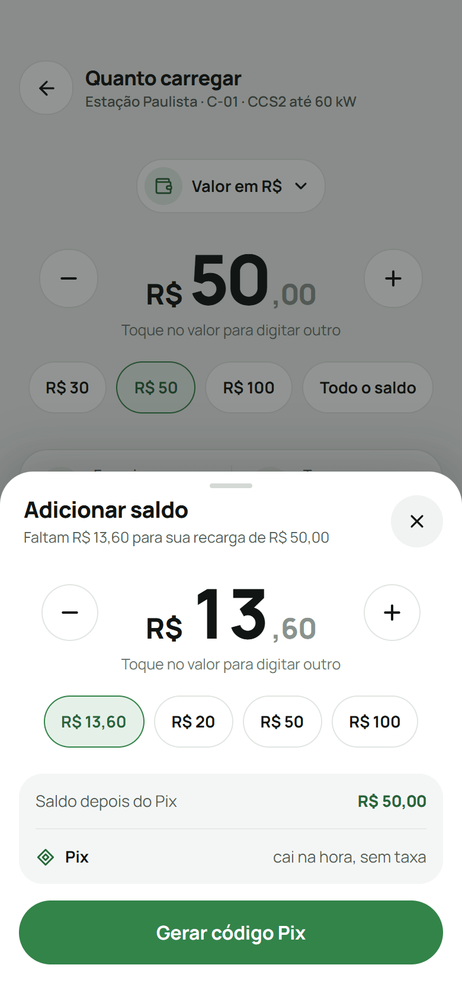 | [PNG](telas/05-06-PagPixSheet.png) · [HTML](html/05-06-PagPixSheet.html) |
| 05-07 | **PagMetodoSheet** Pagamento 1b · Forma de pagamento (sheet do Trocar) | 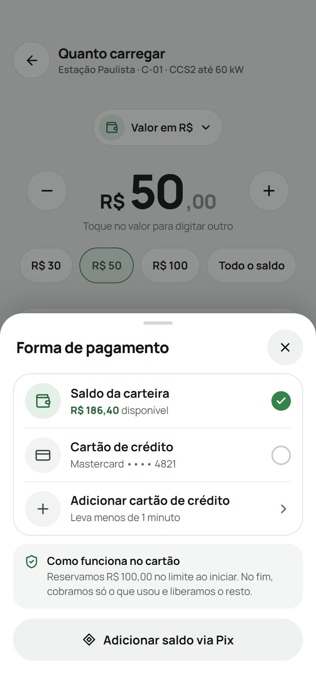 | [PNG](telas/05-07-PagMetodoSheet.png) · [HTML](html/05-07-PagMetodoSheet.html) |
| 05-08 | **SaldoZero** Pagamento · Carteira sem saldo (ao escolher a carteira) | 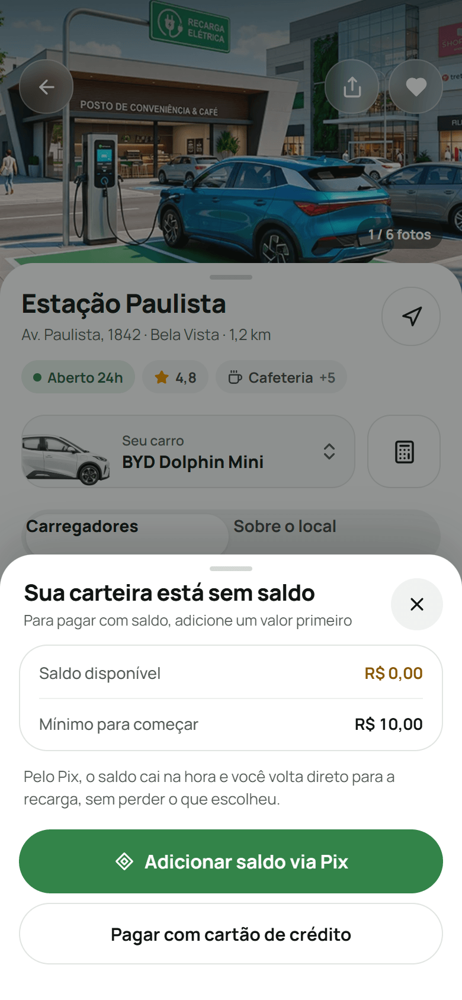 | [PNG](telas/05-08-SaldoZero.png) · [HTML](html/05-08-SaldoZero.html) |
| 05-09 | **PixExpirado** Pagamento · Pix expirado | 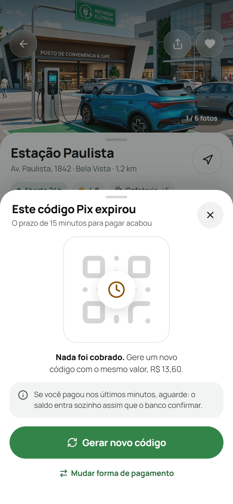 | [PNG](telas/05-09-PixExpirado.png) · [HTML](html/05-09-PixExpirado.html) |

**Caminhos** (de → para: o que dispara)

- _Carregador e conector escolhidos_ → **05-01** PropPrimeiraVez: Primeira recarga
- _Carregador e conector escolhidos_ → **05-02** PropConfira: Já escolheu como pagar
- **05-01** PropPrimeiraVez → **05-02** PropConfira: Continuar
- **05-02** PropConfira → **05-03** PropSaldoInsuf: Saldo não cobre o valor
- **05-03** PropSaldoInsuf → **05-04** PropPixRecarga: Adicionar R$ 13,60 e iniciar
- **05-02** PropConfira → **05-05** PropModo: Botão do valor
- **05-06** PagPixSheet → **05-04** PropPixRecarga: Gerar código Pix
- **05-03** PropSaldoInsuf → **05-06** PagPixSheet: Adicionar outro valor via Pix
- **05-02** PropConfira → **05-07** PagMetodoSheet: Trocar
- **05-08** SaldoZero → **05-06** PagPixSheet: Adicionar saldo via Pix
- **05-07** PagMetodoSheet → **05-08** SaldoZero: Carteira sem saldo
- **05-04** PropPixRecarga → **05-09** PixExpirado: Código expirou
- **05-02** PropConfira → _→ 6. Recarga_: Iniciar recarga
- **05-04** PropPixRecarga → _→ 6. Recarga_: Pix pago: começa sozinha

---

## 06 Recarga

_Conectar o cabo, acompanhar, encerrar e o que pode dar errado_

**O que acontece.** Com o carregador liberado, a pessoa tem 1 minuto para encaixar o cabo (o timer aparece na tela). A tela de recarga mostra a % da bateria, quanto falta, a barra com o início, o ganho e onde vai parar, além de potência, energia, tempo e custo até agora, com opções para alterar o limite, ser avisado e encerrar. A home e as notificações acompanham a carga. A recarga termina no limite escolhido, com a bateria cheia ou quando a pessoa encerra, e cada caso tem seu recibo.

**Regras**

- Se não conectar em 1 minuto, nada é cobrado e a reserva volta para o saldo.
- Ao encerrar antes do fim, paga só a energia recebida e o resto volta para o saldo na hora.
- O recibo mostra energia × R$/kWh + taxa de início, quanto voltou para o saldo e o cashback ganho (5%).
- No cartão, o recibo mostra reservado (R$ 100,00), cobrado (o que usou) e liberado (a diferença). Se o cartão recusa a cobrança final, vira pendência (fluxo 17).
- Falha do carregador: paga só o que recebeu, a taxa de início é estornada e o app sugere outro carregador livre. A cobrança pode ser contestada, com resposta em até 2 dias úteis.
- Cabo desconectado: cobra a energia entregue e a taxa. "Não fui eu" abre uma ocorrência (fluxo 18).
- Carregador AC não informa a % da bateria. A tela mostra kWh e o limite em reais.

**Sai para:** _9. Detalhe da recarga_ · _9. Reportar um problema_

**Telas**

| Nº | Tela | Prévia | Arquivos |
|---|---|---|---|
| 06-01 | **PropConectar** Proposta 4 · Conecte o cabo (une Liberado e Conecte) | 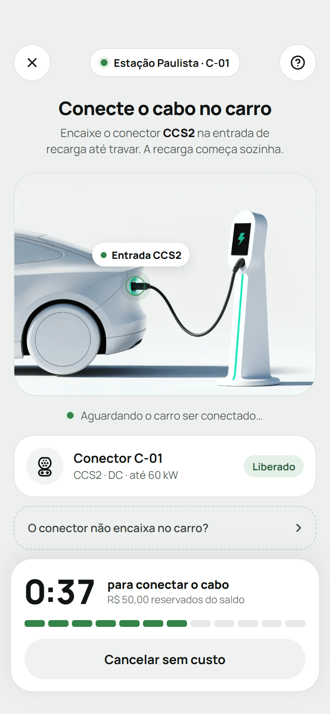 | [PNG](telas/06-01-PropConectar.png) · [HTML](html/06-01-PropConectar.html) |
| 06-02 | **PagCarregando** Pagamento 4 · Carregando | 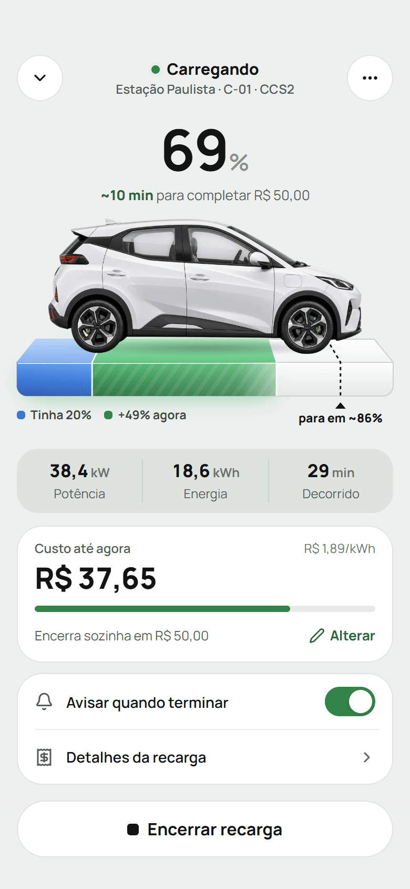 | [PNG](telas/06-02-PagCarregando.png) · [HTML](html/06-02-PagCarregando.html) |
| 06-03 | **HomeAtiva** Recarga · Home com o carro carregando | 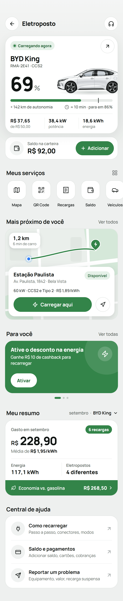 | [PNG](telas/06-03-HomeAtiva.png) · [HTML](html/06-03-HomeAtiva.html) |
| 06-04 | **Notificacoes** Recarga · Notificações enquanto você está longe |  | [PNG](telas/06-04-Notificacoes.png) · [HTML](html/06-04-Notificacoes.html) |
| 06-05 | **TempoEsgotado** Recarga · Tempo para plugar acabou |  | [PNG](telas/06-05-TempoEsgotado.png) · [HTML](html/06-05-TempoEsgotado.html) |
| 06-06 | **CarregandoAC** Recarga · Carregando em AC (sem % da bateria) |  | [PNG](telas/06-06-CarregandoAC.png) · [HTML](html/06-06-CarregandoAC.html) |
| 06-07 | **EncerrarSheet** Recarga · Encerrar a recarga (sheet) |  | [PNG](telas/06-07-EncerrarSheet.png) · [HTML](html/06-07-EncerrarSheet.html) |
| 06-08 | **ConcluidaManual** Recarga · Concluída: encerrada por você |  | [PNG](telas/06-08-ConcluidaManual.png) · [HTML](html/06-08-ConcluidaManual.html) |
| 06-09 | **ConcluidaLimite** Recarga · Concluída: limite atingido |  | [PNG](telas/06-09-ConcluidaLimite.png) · [HTML](html/06-09-ConcluidaLimite.html) |
| 06-10 | **ConcluidaCheia** Recarga · Concluída: bateria cheia |  | [PNG](telas/06-10-ConcluidaCheia.png) · [HTML](html/06-10-ConcluidaCheia.html) |
| 06-11 | **PropConcluida** Proposta 5 · Recarga concluída: reservado, cobrado, liberado |  | [PNG](telas/06-11-PropConcluida.png) · [HTML](html/06-11-PropConcluida.html) |
| 06-12 | **CartaoRecusado** Pagamento · Cartão recusado no fim (pendência) |  | [PNG](telas/06-12-CartaoRecusado.png) · [HTML](html/06-12-CartaoRecusado.html) |
| 06-13 | **Interrompida** Recarga · Interrompida por falha do equipamento |  | [PNG](telas/06-13-Interrompida.png) · [HTML](html/06-13-Interrompida.html) |
| 06-14 | **CaboDesconectado** Recarga · Cabo desconectado no meio |  | [PNG](telas/06-14-CaboDesconectado.png) · [HTML](html/06-14-CaboDesconectado.html) |

**Caminhos** (de → para: o que dispara)

- **06-01** PropConectar → **06-02** PagCarregando: Cabo conectado
- **06-01** PropConectar → **06-05** TempoEsgotado: Não conectou a tempo
- **06-02** PagCarregando → **06-06** CarregandoAC: Carregador AC: sem % da bateria
- **06-02** PagCarregando → **06-03** HomeAtiva: Volta para a home com a recarga rodando
- **06-03** HomeAtiva → **06-04** Notificacoes: Fora do app
- **06-02** PagCarregando → **06-07** EncerrarSheet: Encerrar recarga
- **06-07** EncerrarSheet → **06-08** ConcluidaManual: Encerrar agora
- **06-02** PagCarregando → **06-09** ConcluidaLimite: Chegou ao valor escolhido
- **06-02** PagCarregando → **06-10** ConcluidaCheia: Bateria encheu
- **06-02** PagCarregando → **06-11** PropConcluida: Fim de uma recarga no cartão
- **06-11** PropConcluida → **06-12** CartaoRecusado: Cartão recusado no fim
- **06-02** PagCarregando → **06-13** Interrompida: Falha do carregador
- **06-02** PagCarregando → **06-14** CaboDesconectado: Cabo desconectado
- **06-09** ConcluidaLimite → _→ 9. Detalhe da recarga_: Recibo
- **06-09** ConcluidaLimite → _→ 9. Reportar um problema_: Teve algum problema?

---

## 07 Carteira

_Saldo, cashback, adicionar via Pix, cartões, recargas e extrato_

**O que acontece.** A carteira concentra o saldo, o cashback e o total disponível para recarregar ("com o cashback, você tem R$ 110,50"). Também tem adicionar saldo via Pix, as formas de pagamento (Pix sempre ativo e cartões), o histórico de recargas com gráfico mensal e o extrato com entradas e saídas.

**Regras**

- Adicionar saldo: Pix sem taxa, que cai na hora. Atalhos de R$ 50, 100, 200 ou outro valor. O código copia e cola tem prazo.
- Cashback: vale só em recargas, não pode ser sacado nem transferido, cada crédito vale 60 dias e o que vence antes é usado primeiro.
- Cartões: Visa, Mastercard ou Elo. Ao salvar, o app faz uma verificação de R$ 1,00 que volta na hora. Um cartão pode ser o principal.
- Ordem de uso nas recargas: saldo da carteira (com cashback) ou cartão principal, conforme a escolha da pessoa.

**Sai para:** _9. Detalhe da recarga_

**Telas**

| Nº | Tela | Prévia | Arquivos |
|---|---|---|---|
| 07-01 | **CarteiraHome** Carteira 1 · Minha carteira |  | [PNG](telas/07-01-CarteiraHome.png) · [HTML](html/07-01-CarteiraHome.html) |
| 07-02 | **CarteiraAdicionar** Carteira 2 · Adicionar saldo |  | [PNG](telas/07-02-CarteiraAdicionar.png) · [HTML](html/07-02-CarteiraAdicionar.html) |
| 07-03 | **CarteiraPix** Carteira 2b · Pix gerado |  | [PNG](telas/07-03-CarteiraPix.png) · [HTML](html/07-03-CarteiraPix.html) |
| 07-04 | **CarteiraCashback** Carteira 1b · Cashback |  | [PNG](telas/07-04-CarteiraCashback.png) · [HTML](html/07-04-CarteiraCashback.html) |
| 07-05 | **CarteiraPagamentos** Carteira 3 · Formas de pagamento |  | [PNG](telas/07-05-CarteiraPagamentos.png) · [HTML](html/07-05-CarteiraPagamentos.html) |
| 07-06 | **CarteiraNovoCartao** Carteira 3b · Adicionar cartão |  | [PNG](telas/07-06-CarteiraNovoCartao.png) · [HTML](html/07-06-CarteiraNovoCartao.html) |
| 07-07 | **CarteiraRecargas** Carteira 4 · Minhas recargas |  | [PNG](telas/07-07-CarteiraRecargas.png) · [HTML](html/07-07-CarteiraRecargas.html) |
| 07-08 | **CarteiraExtrato** Carteira 5 · Extrato |  | [PNG](telas/07-08-CarteiraExtrato.png) · [HTML](html/07-08-CarteiraExtrato.html) |

**Caminhos** (de → para: o que dispara)

- **07-01** CarteiraHome → **07-02** CarteiraAdicionar: Adicionar saldo
- **07-02** CarteiraAdicionar → **07-03** CarteiraPix: Gerar código Pix
- **07-01** CarteiraHome → **07-04** CarteiraCashback: Ver regras do cashback
- **07-01** CarteiraHome → **07-05** CarteiraPagamentos: Formas de pagamento · Gerenciar
- **07-05** CarteiraPagamentos → **07-06** CarteiraNovoCartao: Adicionar cartão
- **07-01** CarteiraHome → **07-07** CarteiraRecargas: Minhas recargas
- **07-01** CarteiraHome → **07-08** CarteiraExtrato: Extrato
- **07-07** CarteiraRecargas → _→ 9. Detalhe da recarga_: Toca numa recarga

---

## 08 Veículos

_Lista de veículos e o cadastro (o mesmo do primeiro acesso)_

**O que acontece.** Lista dos veículos da conta. O principal aparece na home e já vem marcado na recarga. Os outros ficam abaixo, com a indicação de carro de aplicativo. Sem nenhum carro, a tela convida a cadastrar, e o cadastro é o mesmo do primeiro acesso (fluxo 1).

**Regras**

- Cada veículo mostra placa, uso (particular ou aplicativo) e os conectores com potência.
- Editar, remover, modelo fora da lista e placa repetida ficam no fluxo 22.

**Sai para:** _1. Novo veículo_

**Telas**

| Nº | Tela | Prévia | Arquivos |
|---|---|---|---|
| 08-01 | **VeiculosListaVazia** Meus veículos · nenhum cadastrado |  | [PNG](telas/08-01-VeiculosListaVazia.png) · [HTML](html/08-01-VeiculosListaVazia.html) |
| 08-02 | **VeiculosLista** Meus veículos (lista) |  | [PNG](telas/08-02-VeiculosLista.png) · [HTML](html/08-02-VeiculosLista.html) |

**Caminhos** (de → para: o que dispara)

- **08-01** VeiculosListaVazia → **08-02** VeiculosLista: Depois do primeiro cadastro
- **08-02** VeiculosLista → _→ 1. Novo veículo_: Cadastrar veículo

---

## 09 Conta e ajuda

_Detalhe da recarga, como recarregar, reportar, configurações e pontos_

**O que acontece.** Telas de apoio. O detalhe de uma recarga traz cobrança, cashback, horários, bateria, potência média, comprovante e "Reportar um problema". O "Reportar um problema" tem motivos, descrição, foto do carregador, chat e telefone. Há também um passo a passo de como recarregar com perguntas frequentes, as configurações (perfil, padrões de recarga, notificações e privacidade) e "Meus pontos", com carregadores de casa ou da empresa.

**Regras**

- O relato vira um chamado com protocolo (fluxo 18).
- Nas configurações dá para definir veículo, forma de pagamento e modo de recarga padrão, e "Lembrar a última recarga".
- Os pontos particulares mostram o status do carregador (livre ou sem conexão) e permitem carregar pelo app como num eletroposto.

**Sai para:** _5. Pagamento_

**Telas**

| Nº | Tela | Prévia | Arquivos |
|---|---|---|---|
| 09-01 | **DetalheRecarga** Conta · Detalhe da recarga |  | [PNG](telas/09-01-DetalheRecarga.png) · [HTML](html/09-01-DetalheRecarga.html) |
| 09-02 | **AjudaReportar** Ajuda · Reportar um problema |  | [PNG](telas/09-02-AjudaReportar.png) · [HTML](html/09-02-AjudaReportar.html) |
| 09-03 | **AjudaComo** Ajuda · Como recarregar (passo a passo) |  | [PNG](telas/09-03-AjudaComo.png) · [HTML](html/09-03-AjudaComo.html) |
| 09-04 | **Configuracoes** Conta · Configurações |  | [PNG](telas/09-04-Configuracoes.png) · [HTML](html/09-04-Configuracoes.html) |
| 09-05 | **MeusPontos** Conta · Meus pontos (carregadores particulares) |  | [PNG](telas/09-05-MeusPontos.png) · [HTML](html/09-05-MeusPontos.html) |

**Caminhos** (de → para: o que dispara)

- **09-01** DetalheRecarga → **09-02** AjudaReportar: Reportar um problema nesta recarga
- **09-03** AjudaComo → **09-02** AjudaReportar: Falar com a gente
- **09-05** MeusPontos → _→ 5. Pagamento_: Carregar aqui

---

## 10 Recarga grátis

_Cashback de energia: ativar o desconto na conta de luz_

**O que acontece.** Ofertas que viram saldo para recarregar. O desconto na conta de luz exige CPF do titular, CEP, distribuidora e número da instalação (ou foto da conta). O seguro do carro elétrico devolve a 1ª mensalidade em saldo. Quando o desconto é ativado, o cashback cai na carteira, pronto para a próxima recarga.

**Regras**

- O cashback de boas-vindas vale só em recargas, tem data de validade e não pode ser sacado.
- O valor aparece como R$ 100 nestas telas e como R$ 10 nos banners. Veja "Pontos em aberto".
- A análise da conta de luz e os casos não elegíveis ficam no fluxo 20.

**Sai para:** _4. Começar a recarga_ · _7. Carteira_

**Telas**

| Nº | Tela | Prévia | Arquivos |
|---|---|---|---|
| 10-01 | **Ofertas** Recarga grátis · Ofertas de cashback |  | [PNG](telas/10-01-Ofertas.png) · [HTML](html/10-01-Ofertas.html) |
| 10-02 | **AtivarEnergia** Recarga grátis · Ativar desconto na conta de luz |  | [PNG](telas/10-02-AtivarEnergia.png) · [HTML](html/10-02-AtivarEnergia.html) |
| 10-03 | **CashbackOk** Recarga grátis · Cashback concedido |  | [PNG](telas/10-03-CashbackOk.png) · [HTML](html/10-03-CashbackOk.html) |

**Caminhos** (de → para: o que dispara)

- **10-01** Ofertas → **10-02** AtivarEnergia: Ativar desconto
- **10-02** AtivarEnergia → **10-03** CashbackOk: Continuar
- **10-03** CashbackOk → _→ 4. Começar a recarga_: Fazer uma recarga
- **10-03** CashbackOk → _→ 7. Carteira_: Ver minha carteira

---

## 11 Carro sem foto no catálogo

_Carro genérico no lugar da foto e o aviso da falta de imagem: a pessoa reporta (A) ou o app avisa sozinho (B)_

**O que acontece.** Quando o catálogo não tem a foto do modelo, o app usa um carro genérico em todas as telas. Há duas propostas para tratar a falta da imagem. Na opção A, a própria pessoa reporta e a home passa a mostrar "Foto solicitada". Na opção B, a recomendada, o app pede a foto sozinho no cadastro e a home mostra "Foto a caminho".

**Regras**

- Recarga, pagamento e histórico funcionam normalmente com o carro genérico.
- A foto real substitui o genérico na home e em Meus veículos assim que fica pronta.

**Telas**

| Nº | Tela | Prévia | Arquivos |
|---|---|---|---|
| 11-01 | **VeiculoNovoSemFoto** Sem foto · Novo veículo com a silhueta Opção A · a pessoa reporta |  | [PNG](telas/11-01-VeiculoNovoSemFoto.png) · [HTML](html/11-01-VeiculoNovoSemFoto.html) |
| 11-02 | **VeiculoOkSemFoto** Sem foto · Veículo cadastrado Opção A · a pessoa reporta |  | [PNG](telas/11-02-VeiculoOkSemFoto.png) · [HTML](html/11-02-VeiculoOkSemFoto.html) |
| 11-03 | **HomeSemFoto** Sem foto · Home com "Reportar falta de imagem" Opção A · a pessoa reporta |  | [PNG](telas/11-03-HomeSemFoto.png) · [HTML](html/11-03-HomeSemFoto.html) |
| 11-04 | **SemFotoReportarSheet** Sem foto · Reportar falta de imagem (sheet) Opção A · a pessoa reporta |  | [PNG](telas/11-04-SemFotoReportarSheet.png) · [HTML](html/11-04-SemFotoReportarSheet.html) |
| 11-05 | **HomeSemFotoReportada** Sem foto · Home depois de reportar Opção A · a pessoa reporta |  | [PNG](telas/11-05-HomeSemFotoReportada.png) · [HTML](html/11-05-HomeSemFotoReportada.html) |
| 11-06 | **HomeSemFotoAuto** Sem foto · Home com reporte automático Opção B · o app avisa sozinho (recomendada) |  | [PNG](telas/11-06-HomeSemFotoAuto.png) · [HTML](html/11-06-HomeSemFotoAuto.html) |
| 11-07 | **SemFotoAutoSheet** Sem foto · Reporte automático (sheet) Opção B · o app avisa sozinho (recomendada) |  | [PNG](telas/11-07-SemFotoAutoSheet.png) · [HTML](html/11-07-SemFotoAutoSheet.html) |
| 11-08 | **VeiculosListaSemFoto** Sem foto · Meus veículos Outras telas com o carro genérico |  | [PNG](telas/11-08-VeiculosListaSemFoto.png) · [HTML](html/11-08-VeiculosListaSemFoto.html) |
| 11-09 | **HomeAtivaSemFoto** Sem foto · Home com o carro carregando Outras telas com o carro genérico |  | [PNG](telas/11-09-HomeAtivaSemFoto.png) · [HTML](html/11-09-HomeAtivaSemFoto.html) |

**Caminhos** (de → para: o que dispara)

- **11-01** VeiculoNovoSemFoto → **11-02** VeiculoOkSemFoto: Cadastrar veículo
- **11-02** VeiculoOkSemFoto → **11-03** HomeSemFoto: Ir para o início
- **11-03** HomeSemFoto → **11-04** SemFotoReportarSheet: Reportar falta de imagem
- **11-04** SemFotoReportarSheet → **11-05** HomeSemFotoReportada: Avisar a equipe
- **11-02** VeiculoOkSemFoto → **11-06** HomeSemFotoAuto: Ir para o início · pedido de foto automático
- **11-06** HomeSemFotoAuto → **11-07** SemFotoAutoSheet: Toca em Foto a caminho

---

## 12 Banners da seção Para você

_Propostas de banner para a home: energia (desconto na conta de luz) e seguro auto, os dois com R$ 10 de cashback na carteira. Cada quadro mostra a dupla energia + seguro._

**O que acontece.** Propostas de banner para o carrossel "Para você" da home: o desconto na conta de luz e o seguro auto, os dois com R$ 10 de cashback. Cada quadro mostra a dupla energia + seguro. A rodada 2 tem os ajustes das propostas mantidas e a rodada 3 tem 10 propostas novas (P13 a P22).

**Regras**

- São explorações de design, não telas de fluxo.
- A proposta 13 ("objeto que salta do card") foi a escolhida para o teste das homes do carro verde (fluxo 28).

**Telas**

| Nº | Tela | Prévia | Arquivos |
|---|---|---|---|
| 12-01 | **BannerP1** Banners · Proposta 1 · Cor profunda + objeto 3D Rodada 2 ajustada · 1 e 2 originais, 1 v2 com mais respiro |  | [PNG](telas/12-01-BannerP1.png) · [HTML](html/12-01-BannerP1.html) |
| 12-02 | **BannerP1V2** Banners · Proposta 1 · v2 · Cor profunda + objeto 3D Rodada 2 ajustada · 1 e 2 originais, 1 v2 com mais respiro |  | [PNG](telas/12-02-BannerP1V2.png) · [HTML](html/12-02-BannerP1V2.html) |
| 12-03 | **BannerP2** Banners · Proposta 2 · Branco + objeto escultural Rodada 2 ajustada · 1 e 2 originais, 1 v2 com mais respiro |  | [PNG](telas/12-03-BannerP2.png) · [HTML](html/12-03-BannerP2.html) |
| 12-04 | **BannerP3** Banners · Proposta 3 · Ticket que sai do card Rodada 2 ajustada · 1 e 2 originais, 1 v2 com mais respiro |  | [PNG](telas/12-04-BannerP3.png) · [HTML](html/12-04-BannerP3.html) |
| 12-05 | **BannerP4** Banners · Proposta 4 · Cofre esmeralda Rodada 2 ajustada · 1 e 2 originais, 1 v2 com mais respiro |  | [PNG](telas/12-05-BannerP4.png) · [HTML](html/12-05-BannerP4.html) |
| 12-06 | **BannerP5** Banners · Proposta 5 · Argila verde-lima Rodada 2 ajustada · 1 e 2 originais, 1 v2 com mais respiro |  | [PNG](telas/12-06-BannerP5.png) · [HTML](html/12-06-BannerP5.html) |
| 12-07 | **BannerP8** Banners · Proposta 8 · Faixa compacta Rodada 2 ajustada · 1 e 2 originais, 1 v2 com mais respiro |  | [PNG](telas/12-07-BannerP8.png) · [HTML](html/12-07-BannerP8.html) |
| 12-08 | **BannerP9** Banners · Proposta 9 · Cards verticais Rodada 2 ajustada · 1 e 2 originais, 1 v2 com mais respiro |  | [PNG](telas/12-08-BannerP9.png) · [HTML](html/12-08-BannerP9.html) |
| 12-09 | **BannerP10** Banners · Proposta 10 · Carteira com cartão Rodada 2 ajustada · 1 e 2 originais, 1 v2 com mais respiro |  | [PNG](telas/12-09-BannerP10.png) · [HTML](html/12-09-BannerP10.html) |
| 12-10 | **BannerP11** Banners · Proposta 11 · Missão em 3 passos Rodada 2 ajustada · 1 e 2 originais, 1 v2 com mais respiro |  | [PNG](telas/12-10-BannerP11.png) · [HTML](html/12-10-BannerP11.html) |
| 12-11 | **BannerP12** Banners · Proposta 12 · Etiqueta pendurada Rodada 2 ajustada · 1 e 2 originais, 1 v2 com mais respiro |  | [PNG](telas/12-11-BannerP12.png) · [HTML](html/12-11-BannerP12.html) |
| 12-12 | **BannerP13** Banners · Proposta 13 · Objeto que salta do card Rodada 3 · 10 propostas novas |  | [PNG](telas/12-12-BannerP13.png) · [HTML](html/12-12-BannerP13.html) |
| 12-13 | **BannerP14** Banners · Proposta 14 · Missão centralizada Rodada 3 · 10 propostas novas |  | [PNG](telas/12-13-BannerP14.png) · [HTML](html/12-13-BannerP14.html) |
| 12-14 | **BannerP15** Banners · Proposta 15 · Título gigante em carrossel Rodada 3 · 10 propostas novas |  | [PNG](telas/12-14-BannerP15.png) · [HTML](html/12-14-BannerP15.html) |
| 12-15 | **BannerP16** Banners · Proposta 16 · Personagem no pódio Rodada 3 · 10 propostas novas |  | [PNG](telas/12-15-BannerP16.png) · [HTML](html/12-15-BannerP16.html) |
| 12-16 | **BannerP17** Banners · Proposta 17 · Formas e marca-texto Rodada 3 · 10 propostas novas |  | [PNG](telas/12-16-BannerP17.png) · [HTML](html/12-16-BannerP17.html) |
| 12-17 | **BannerP18** Banners · Proposta 18 · Cápsulas geométricas Rodada 3 · 10 propostas novas |  | [PNG](telas/12-17-BannerP18.png) · [HTML](html/12-17-BannerP18.html) |
| 12-18 | **BannerP19** Banners · Proposta 19 · Promoção com celular Rodada 3 · 10 propostas novas |  | [PNG](telas/12-18-BannerP19.png) · [HTML](html/12-18-BannerP19.html) |
| 12-19 | **BannerP20** Banners · Proposta 20 · Número gigante no escuro Rodada 3 · 10 propostas novas |  | [PNG](telas/12-19-BannerP20.png) · [HTML](html/12-19-BannerP20.html) |
| 12-20 | **BannerP21** Banners · Proposta 21 · Aba e objetos por baixo Rodada 3 · 10 propostas novas |  | [PNG](telas/12-20-BannerP21.png) · [HTML](html/12-20-BannerP21.html) |
| 12-21 | **BannerP22** Banners · Proposta 22 · Celular com a conta Rodada 3 · 10 propostas novas |  | [PNG](telas/12-21-BannerP22.png) · [HTML](html/12-21-BannerP22.html) |

---

## 13 Entrar e criar conta

_Depois das boas-vindas: uma tela só identifica a pessoa por CPF, e-mail ou celular e segue pelo caminho certo_

**O que acontece.** Uma tela só identifica a pessoa por CPF, e-mail ou celular. Se já é cliente, o app pede um canal ligado ao CPF (e-mail, SMS ou WhatsApp), envia um código de 6 dígitos e a pessoa cria uma senha de 6 dígitos e decide se ativa a biometria. Se ainda não é cliente, cria a conta com o essencial. Também é possível entrar com o Google.

**Regras**

- O código chega pelo canal escolhido e pode ser reenviado depois do contador. A iGreen nunca pede esse código por telefone, WhatsApp ou e-mail.
- Mais de um e-mail no CPF: o escolhido vira o oficial e os outros ficam salvos para recuperar o acesso. "Nenhum desses é meu" cadastra um e-mail novo.
- Google: conta nova pede o CPF. Se o CPF não tem conta, completa nascimento e celular. Se o e-mail já tem conta, pede a senha uma vez para vincular, e depois disso o Google vira atalho.
- Conta nova pede nome, nascimento, e-mail, celular (confirmado por código) e o aceite dos termos.

**Chega aqui por:** _Boas-vindas · Começar agora ou Pular_

**Sai para:** _1. Permissões e veículo_ · _2. Home_

**Telas**

| Nº | Tela | Prévia | Arquivos |
|---|---|---|---|
| 13-01 | **LoginIdentificar** Login · Digite seu CPF, e-mail ou celular |  | [PNG](telas/13-01-LoginIdentificar.png) · [HTML](html/13-01-LoginIdentificar.html) |
| 13-02 | **LoginCanal** Login · Para onde enviamos o código |  | [PNG](telas/13-02-LoginCanal.png) · [HTML](html/13-02-LoginCanal.html) |
| 13-03 | **LoginCodigo** Login · Código de 6 dígitos |  | [PNG](telas/13-03-LoginCodigo.png) · [HTML](html/13-03-LoginCodigo.html) |
| 13-04 | **LoginCriarSenha** Login · Crie sua senha de 6 dígitos |  | [PNG](telas/13-04-LoginCriarSenha.png) · [HTML](html/13-04-LoginCriarSenha.html) |
| 13-05 | **LoginBiometria** Login · Ativar biometria neste aparelho |  | [PNG](telas/13-05-LoginBiometria.png) · [HTML](html/13-05-LoginBiometria.html) |
| 13-06 | **LoginCriarConta** Login · Ainda não é cliente: criar conta Mais de um e-mail no CPF e quem ainda não é cliente |  | [PNG](telas/13-06-LoginCriarConta.png) · [HTML](html/13-06-LoginCriarConta.html) |
| 13-07 | **LoginQualEmail** Login · Qual desses e-mails é seu Mais de um e-mail no CPF e quem ainda não é cliente |  | [PNG](telas/13-07-LoginQualEmail.png) · [HTML](html/13-07-LoginQualEmail.html) |
| 13-08 | **LoginNovoEmail** Login · Cadastre o e-mail que é seu Mais de um e-mail no CPF e quem ainda não é cliente |  | [PNG](telas/13-08-LoginNovoEmail.png) · [HTML](html/13-08-LoginNovoEmail.html) |
| 13-09 | **LoginCodigoErro** Login · Código incorreto Mais de um e-mail no CPF e quem ainda não é cliente |  | [PNG](telas/13-09-LoginCodigoErro.png) · [HTML](html/13-09-LoginCodigoErro.html) |
| 13-10 | **LoginGoogleConta** Login · Google: escolher a conta Entrar com o Google |  | [PNG](telas/13-10-LoginGoogleConta.png) · [HTML](html/13-10-LoginGoogleConta.html) |
| 13-11 | **LoginGoogleCpf** Login · Google: falta só o CPF Entrar com o Google |  | [PNG](telas/13-11-LoginGoogleCpf.png) · [HTML](html/13-11-LoginGoogleCpf.html) |
| 13-12 | **LoginGoogleCompletar** Login · Google: complete seu cadastro Entrar com o Google |  | [PNG](telas/13-12-LoginGoogleCompletar.png) · [HTML](html/13-12-LoginGoogleCompletar.html) |
| 13-13 | **LoginGoogleVincular** Login · Google: já existe conta com esse e-mail Entrar com o Google |  | [PNG](telas/13-13-LoginGoogleVincular.png) · [HTML](html/13-13-LoginGoogleVincular.html) |

**Caminhos** (de → para: o que dispara)

- _Boas-vindas · Começar agora ou Pular_ → **13-01** LoginIdentificar: Abre a identificação
- **13-01** LoginIdentificar → **13-02** LoginCanal: Já é cliente
- **13-02** LoginCanal → **13-03** LoginCodigo: Enviar código
- **13-03** LoginCodigo → **13-04** LoginCriarSenha: Código certo
- **13-04** LoginCriarSenha → **13-05** LoginBiometria: Criar senha
- **13-05** LoginBiometria → _→ 1. Permissões e veículo_: Ativar ou Agora não
- **13-01** LoginIdentificar → **13-06** LoginCriarConta: Ainda não é cliente
- **13-06** LoginCriarConta → **13-03** LoginCodigo: Continuar
- **13-02** LoginCanal → **13-07** LoginQualEmail: Mais de um e-mail no CPF
- **13-07** LoginQualEmail → **13-08** LoginNovoEmail: Nenhum desses é meu
- **13-08** LoginNovoEmail → **13-03** LoginCodigo: Continuar
- **13-03** LoginCodigo → **13-09** LoginCodigoErro: Código errado
- **13-10** LoginGoogleConta → **13-11** LoginGoogleCpf: Conta nova no Google
- **13-11** LoginGoogleCpf → **13-12** LoginGoogleCompletar: CPF sem conta iGreen
- **13-12** LoginGoogleCompletar → **13-03** LoginCodigo: Continuar · confirma o celular
- **13-11** LoginGoogleCpf → **13-13** LoginGoogleVincular: E-mail já tem conta
- **13-13** LoginGoogleVincular → _→ 2. Home_: Vincular e entrar

---

## 14 Voltar ao app

_Biometria, senha, tentativas erradas, aparelho novo e sessão expirada_

**O que acontece.** Na volta ao app, a biometria do sistema abre o app direto. Se a pessoa cancela ou a biometria falha, ela usa a digital de novo ou a senha. O fluxo cobre senha errada, bloqueio após 3 erros, criação de senha nova, sessão expirada, biometria desligada pelo sistema e aparelho novo.

**Regras**

- Três senhas erradas pausam o acesso por 30 minutos. Recargas em andamento continuam.
- Sessão expira depois de 30 dias sem usar o app: pede a senha de novo, e recargas em andamento não param.
- Biometria desligada pelo sistema (digital ou rosto novo no celular): entra com a senha e reativa, sem código nem espera.
- Aparelho novo: depois da senha, um código prepara o aparelho. Até lá, cada recarga fica limitada a R$ 200.

**Chega aqui por:** _Abre o app com a conta salva_

**Sai para:** _2. Home_ · _13. Código de 6 dígitos_

**Telas**

| Nº | Tela | Prévia | Arquivos |
|---|---|---|---|
| 14-01 | **LoginSplash** Login · Abrir com biometria |  | [PNG](telas/14-01-LoginSplash.png) · [HTML](html/14-01-LoginSplash.html) |
| 14-02 | **LoginDigital** Login · Biometria cancelada: digital ou senha |  | [PNG](telas/14-02-LoginDigital.png) · [HTML](html/14-02-LoginDigital.html) |
| 14-03 | **LoginSenha** Login · Senha de 6 dígitos |  | [PNG](telas/14-03-LoginSenha.png) · [HTML](html/14-03-LoginSenha.html) |
| 14-04 | **LoginSenhaErro** Login · Senha incorreta Senha errada e esqueci a senha |  | [PNG](telas/14-04-LoginSenhaErro.png) · [HTML](html/14-04-LoginSenhaErro.html) |
| 14-05 | **LoginBloqueado** Login · Acesso pausado por tentativas Senha errada e esqueci a senha |  | [PNG](telas/14-05-LoginBloqueado.png) · [HTML](html/14-05-LoginBloqueado.html) |
| 14-06 | **SenhaRedefinida** Login · Senha nova criada (esqueci a senha) Senha errada e esqueci a senha |  | [PNG](telas/14-06-SenhaRedefinida.png) · [HTML](html/14-06-SenhaRedefinida.html) |
| 14-07 | **SessaoExpirada** Conta · Sessão expirada (sheet) Sessão expirada, biometria desligada e aparelho novo |  | [PNG](telas/14-07-SessaoExpirada.png) · [HTML](html/14-07-SessaoExpirada.html) |
| 14-08 | **LoginBiometriaOff** Login · Biometria desativada pelo sistema Sessão expirada, biometria desligada e aparelho novo |  | [PNG](telas/14-08-LoginBiometriaOff.png) · [HTML](html/14-08-LoginBiometriaOff.html) |
| 14-09 | **LoginNovoAparelho** Login · Aparelho novo: senha Sessão expirada, biometria desligada e aparelho novo |  | [PNG](telas/14-09-LoginNovoAparelho.png) · [HTML](html/14-09-LoginNovoAparelho.html) |
| 14-10 | **LoginPrepararAparelho** Login · Aparelho novo: vamos preparar Sessão expirada, biometria desligada e aparelho novo |  | [PNG](telas/14-10-LoginPrepararAparelho.png) · [HTML](html/14-10-LoginPrepararAparelho.html) |

**Caminhos** (de → para: o que dispara)

- _Abre o app com a conta salva_ → **14-01** LoginSplash: Biometria ativa
- **14-01** LoginSplash → _→ 2. Home_: Digital reconhecida
- **14-01** LoginSplash → **14-02** LoginDigital: Cancelar ou falhou
- **14-02** LoginDigital → **14-03** LoginSenha: Usar minha senha
- **14-03** LoginSenha → _→ 2. Home_: Entrar
- **14-03** LoginSenha → **14-04** LoginSenhaErro: Senha errada
- **14-04** LoginSenhaErro → **14-05** LoginBloqueado: 3ª tentativa errada
- **14-05** LoginBloqueado → **14-06** SenhaRedefinida: Criar uma nova senha (o mesmo de “Esqueci minha senha”)
- **14-06** SenhaRedefinida → _→ 2. Home_: Entrar no app
- **14-07** SessaoExpirada → **14-03** LoginSenha: Entrar de novo
- **14-08** LoginBiometriaOff → **14-03** LoginSenha: Entrar com a senha e reativar
- **14-09** LoginNovoAparelho → **14-10** LoginPrepararAparelho: Senha certa num aparelho novo
- **14-10** LoginPrepararAparelho → _→ 13. Código de 6 dígitos_: Receber o código

---

## 15 Ajuda de segurança

_O “?” das telas de login: não consigo entrar, roubo, uso indevido e cadastro que não é meu_

**O que acontece.** O "?" das telas de login abre a ajuda de segurança. Para "Não consigo entrar", há três caminhos: dados de uma recarga recente (na hora), documento e selfie (análise em até 24 horas) ou atendimento. Para roubo, uso indevido ou cadastro que não é meu, a pessoa pode bloquear os pagamentos na hora.

**Regras**

- O bloqueio é imediato e suspende recargas novas, Pix, cartões salvos e alteração de dados.
- Continuam funcionando a recarga em andamento (até o fim), o mapa, o histórico, os comprovantes e o suporte.
- O desbloqueio exige documento e selfie, com análise em até 24 horas. O bloqueio gera um protocolo.

**Chega aqui por:** _? em qualquer tela de login_

**Sai para:** _Atendimento ou análise de documento_

**Telas**

| Nº | Tela | Prévia | Arquivos |
|---|---|---|---|
| 15-01 | **LoginAjuda** Login · Ajuda de segurança |  | [PNG](telas/15-01-LoginAjuda.png) · [HTML](html/15-01-LoginAjuda.html) |
| 15-02 | **LoginIdentidade** Login · Confirmar a identidade de outro jeito |  | [PNG](telas/15-02-LoginIdentidade.png) · [HTML](html/15-02-LoginIdentidade.html) |
| 15-03 | **LoginBloquearPagamentos** Login · Bloquear pagamentos da conta |  | [PNG](telas/15-03-LoginBloquearPagamentos.png) · [HTML](html/15-03-LoginBloquearPagamentos.html) |
| 15-04 | **LoginBloqueioOk** Login · Pagamentos bloqueados |  | [PNG](telas/15-04-LoginBloqueioOk.png) · [HTML](html/15-04-LoginBloqueioOk.html) |

**Caminhos** (de → para: o que dispara)

- _? em qualquer tela de login_ → **15-01** LoginAjuda: Ajuda com a conta
- **15-01** LoginAjuda → **15-02** LoginIdentidade: Não consigo entrar
- **15-02** LoginIdentidade → _→ Atendimento ou análise de documento_: Documento e selfie ou atendimento
- **15-01** LoginAjuda → **15-03** LoginBloquearPagamentos: Roubo, uso indevido ou cadastro que não é meu
- **15-03** LoginBloquearPagamentos → **15-04** LoginBloqueioOk: Bloquear pagamentos agora

---

## 16 Conta sem carro

_Quem pulou o cadastro do carro no primeiro acesso: a home convida a cadastrar_

**O que acontece.** Quem pulou o cadastro do carro no primeiro acesso cai numa home que convida a cadastrar. O card do veículo mostra uma silhueta e o botão "Cadastrar veículo", que leva ao cadastro do fluxo 1.

**Regras**

- Sem carro cadastrado, o app ainda não sabe quais conectores servem, por isso o mapa e o custo ficam genéricos.

**Chega aqui por:** _Primeiro acesso · pulou o cadastro do carro_

**Sai para:** _1. Novo veículo_

**Telas**

| Nº | Tela | Prévia | Arquivos |
|---|---|---|---|
| 16-01 | **HomeSemVeiculo** Conta · Home sem veículo cadastrado |  | [PNG](telas/16-01-HomeSemVeiculo.png) · [HTML](html/16-01-HomeSemVeiculo.html) |

**Caminhos** (de → para: o que dispara)

- _Primeiro acesso · pulou o cadastro do carro_ → **16-01** HomeSemVeiculo: Abre a home
- **16-01** HomeSemVeiculo → _→ 1. Novo veículo_: Cadastrar veículo

---

## 17 Dinheiro pendente

_Reserva recusada no início, carregador que não começa e pendência de uma recarga anterior_

**O que acontece.** Os casos em que o dinheiro fica em suspenso: o banco recusa a reserva do cartão ao iniciar, o carregador não começa depois que o cabo foi conectado, ou sobra uma pendência de uma recarga anterior (cartão recusado no fim). A home mostra a pendência em destaque, e uma nova recarga só começa depois de quitar.

**Regras**

- Reserva recusada: nada é cobrado e o carregador fica guardado por 3 minutos enquanto a pessoa paga via Pix, com o saldo ou com outro cartão.
- Carregador não iniciou: a reserva volta para o saldo (cobrado R$ 0,00). A pessoa pode tentar de novo, escolher outro carregador ou reportar.
- Pendência: o alerta fica fixo na home. Ao tentar carregar, um sheet pede para quitar antes, via Pix ou outro cartão.

**Chega aqui por:** _5. Confira e inicie · pagando com cartão_ · _6. Conecte o cabo · cabo conectado_ · _6. Cartão recusado no fim_

**Sai para:** _5. Pix, saldo ou outro cartão_ · _6. Carregando_ · _18. Reportar o carregador_ · _5. Pagamento no C-01_

**Telas**

| Nº | Tela | Prévia | Arquivos |
|---|---|---|---|
| 17-01 | **ReservaRecusada** Pagamento · Cartão recusou a reserva ao iniciar |  | [PNG](telas/17-01-ReservaRecusada.png) · [HTML](html/17-01-ReservaRecusada.html) |
| 17-02 | **Iniciando** Recarga · Iniciando: o carregador confirma o carro |  | [PNG](telas/17-02-Iniciando.png) · [HTML](html/17-02-Iniciando.html) |
| 17-03 | **NaoIniciou** Recarga · O carregador não iniciou |  | [PNG](telas/17-03-NaoIniciou.png) · [HTML](html/17-03-NaoIniciou.html) |
| 17-04 | **HomePendencia** Pagamento · Home com pendência em aberto |  | [PNG](telas/17-04-HomePendencia.png) · [HTML](html/17-04-HomePendencia.html) |
| 17-05 | **PendenciaBloqueio** Pagamento · Pendência impede nova recarga (sheet) |  | [PNG](telas/17-05-PendenciaBloqueio.png) · [HTML](html/17-05-PendenciaBloqueio.html) |
| 17-06 | **PendenciaPaga** Pagamento · Pendência quitada |  | [PNG](telas/17-06-PendenciaPaga.png) · [HTML](html/17-06-PendenciaPaga.html) |

**Caminhos** (de → para: o que dispara)

- _5. Confira e inicie · pagando com cartão_ → **17-01** ReservaRecusada: Banco não aprova a reserva
- **17-01** ReservaRecusada → _→ 5. Pix, saldo ou outro cartão_: Pagar via Pix ou usar outro cartão
- _6. Conecte o cabo · cabo conectado_ → **17-02** Iniciando: O carregador confirma o carro
- **17-02** Iniciando → _→ 6. Carregando_: Energia começou
- **17-02** Iniciando → **17-03** NaoIniciou: Carregador não respondeu
- **17-03** NaoIniciou → _→ 18. Reportar o carregador_: Reportar este carregador
- _6. Cartão recusado no fim_ → **17-04** HomePendencia: Volta para a home
- **17-04** HomePendencia → **17-05** PendenciaBloqueio: Tenta carregar de novo
- **17-05** PendenciaBloqueio → **17-06** PendenciaPaga: Pagar via Pix
- **17-06** PendenciaPaga → _→ 5. Pagamento no C-01_: Carregar no C-01

---

## 18 Reportar e acompanhar

_Todo relato vira um chamado com protocolo, prazo e resposta, inclusive contestação e “não fui eu”_

**O que acontece.** Todo relato vira um chamado com protocolo, prazo e resposta. Isso vale para problema na recarga, contestação de cobrança, "não fui eu" (cabo desconectado) e conversa no chat. "Meus chamados" separa abertos e resolvidos, e o detalhe mostra o andamento e o estorno quando há.

**Regras**

- Análise em até 2 dias úteis, com aviso por notificação.
- O estorno volta pela mesma forma de pagamento (ou para o saldo da carteira).
- Na contestação, a pessoa informa o motivo, a energia que o carro registrou e uma foto do painel, se tiver.
- "Não fui eu" registra horário e carregador, o posto é avisado e a pessoa paga só a energia que entrou.

**Chega aqui por:** _9. Reportar um problema · Enviar_ · _6. Interrompida · Contestar a cobrança_ · _6. Cabo desconectado · Não fui eu_ · _9. Ajuda · Falar com a gente_

**Telas**

| Nº | Tela | Prévia | Arquivos |
|---|---|---|---|
| 18-01 | **ReportEnviado** Ajuda · Relato enviado com protocolo |  | [PNG](telas/18-01-ReportEnviado.png) · [HTML](html/18-01-ReportEnviado.html) |
| 18-02 | **MeusChamados** Ajuda · Meus chamados |  | [PNG](telas/18-02-MeusChamados.png) · [HTML](html/18-02-MeusChamados.html) |
| 18-03 | **ChamadoDetalhe** Ajuda · Chamado resolvido com estorno |  | [PNG](telas/18-03-ChamadoDetalhe.png) · [HTML](html/18-03-ChamadoDetalhe.html) |
| 18-04 | **Contestar** Ajuda · Contestar a cobrança |  | [PNG](telas/18-04-Contestar.png) · [HTML](html/18-04-Contestar.html) |
| 18-05 | **NaoFuiEu** Recarga · Cabo desconectado: não fui eu (sheet) |  | [PNG](telas/18-05-NaoFuiEu.png) · [HTML](html/18-05-NaoFuiEu.html) |
| 18-06 | **ChatSuporte** Ajuda · Chat com o atendimento |  | [PNG](telas/18-06-ChatSuporte.png) · [HTML](html/18-06-ChatSuporte.html) |

**Caminhos** (de → para: o que dispara)

- _9. Reportar um problema · Enviar_ → **18-01** ReportEnviado: Relato enviado
- **18-01** ReportEnviado → **18-02** MeusChamados: Acompanhar em Meus chamados
- **18-02** MeusChamados → **18-03** ChamadoDetalhe: Toca num chamado resolvido
- _6. Interrompida · Contestar a cobrança_ → **18-04** Contestar: Contestar a cobrança
- **18-04** Contestar → **18-01** ReportEnviado: Enviar contestação
- _6. Cabo desconectado · Não fui eu_ → **18-05** NaoFuiEu: Não fui eu
- **18-05** NaoFuiEu → **18-01** ReportEnviado: Registrar ocorrência
- _9. Ajuda · Falar com a gente_ → **18-06** ChatSuporte: Chat
- **18-06** ChatSuporte → **18-02** MeusChamados: Contestação aberta pelo chat

---

## 19 Seguro auto

_Dos banners “Simular seguro” até a apólice, com R$ 10 de cashback na 1ª mensalidade_

**O que acontece.** Simulação e contratação do seguro auto para elétrico, a partir do banner "Simular seguro". A pessoa informa os dados para a cotação (carro, CEP, condutor, uso e garagem), compara três planos, vê os detalhes e contrata com o cartão. No fim recebe a apólice e o cashback.

**Regras**

- Planos de exemplo: Essencial R$ 189, Completo R$ 236 (mais escolhido) e Completo + vidros R$ 259 por mês, por 12 meses.
- Coberturas pensadas para elétrico: bateria de alta tensão e cabo, guincho até um carregador e oficinas que consertam elétricos.
- A cotação vale 7 dias, com franquia a partir de R$ 4.800. O seguro é de uma seguradora parceira.
- A contratação dá R$ 10,00 de cashback na carteira. Em Ofertas, aparece como "1ª mensalidade de volta".

**Chega aqui por:** _Banner Para você · Simular seguro_

**Sai para:** _2. Home_

**Telas**

| Nº | Tela | Prévia | Arquivos |
|---|---|---|---|
| 19-01 | **SeguroInicio** Seguro auto · O seguro do seu elétrico |  | [PNG](telas/19-01-SeguroInicio.png) · [HTML](html/19-01-SeguroInicio.html) |
| 19-02 | **SeguroDados** Seguro auto · Dados para a cotação |  | [PNG](telas/19-02-SeguroDados.png) · [HTML](html/19-02-SeguroDados.html) |
| 19-03 | **SeguroCotacoes** Seguro auto · Três cotações para comparar |  | [PNG](telas/19-03-SeguroCotacoes.png) · [HTML](html/19-03-SeguroCotacoes.html) |
| 19-04 | **SeguroPlano** Seguro auto · Detalhes do plano Completo |  | [PNG](telas/19-04-SeguroPlano.png) · [HTML](html/19-04-SeguroPlano.html) |
| 19-05 | **SeguroContratar** Seguro auto · Confira e contrate |  | [PNG](telas/19-05-SeguroContratar.png) · [HTML](html/19-05-SeguroContratar.html) |
| 19-06 | **SeguroContratado** Seguro auto · Contratado |  | [PNG](telas/19-06-SeguroContratado.png) · [HTML](html/19-06-SeguroContratado.html) |

**Caminhos** (de → para: o que dispara)

- _Banner Para você · Simular seguro_ → **19-01** SeguroInicio: Abre o seguro
- **19-01** SeguroInicio → **19-02** SeguroDados: Simular agora
- **19-02** SeguroDados → **19-03** SeguroCotacoes: Ver cotações
- **19-03** SeguroCotacoes → **19-04** SeguroPlano: Ver detalhes do plano
- **19-03** SeguroCotacoes → **19-05** SeguroContratar: Continuar com o Completo
- **19-04** SeguroPlano → **19-05** SeguroContratar: Contratar
- **19-05** SeguroContratar → **19-06** SeguroContratado: Contratar seguro
- **19-06** SeguroContratado → _→ 2. Home_: Ir para o início

---

## 20 Desconto na conta de luz

_Depois de ativar: foto da conta, análise da distribuidora e quando a conta não é elegível_

**O que acontece.** Depois de pedir o desconto na conta de luz, a pessoa pode enviar uma foto da conta. Os dados entram em análise com a distribuidora, e o fluxo mostra o que acontece quando a conta não é elegível.

**Regras**

- A análise leva até 2 dias úteis. Nada muda na conta de luz enquanto isso.
- Aprovado: o desconto aparece a partir da próxima conta e o cashback cai na carteira.
- Não elegível: distribuidora não atendida, conta em nome de outra pessoa, consumo abaixo de 150 kWh/mês ou geração própria. A pessoa pode pedir aviso quando a região for atendida.

**Chega aqui por:** _10. Ativar desconto · Continuar_ · _10. Prefere enviar uma foto da conta?_

**Sai para:** _10. Cashback concedido_

**Telas**

| Nº | Tela | Prévia | Arquivos |
|---|---|---|---|
| 20-01 | **EnergiaFoto** Recarga grátis · Enviar foto da conta de luz |  | [PNG](telas/20-01-EnergiaFoto.png) · [HTML](html/20-01-EnergiaFoto.html) |
| 20-02 | **EnergiaAnalise** Recarga grátis · Conta de luz em análise |  | [PNG](telas/20-02-EnergiaAnalise.png) · [HTML](html/20-02-EnergiaAnalise.html) |
| 20-03 | **EnergiaNaoElegivel** Recarga grátis · Conta de luz não elegível |  | [PNG](telas/20-03-EnergiaNaoElegivel.png) · [HTML](html/20-03-EnergiaNaoElegivel.html) |

**Caminhos** (de → para: o que dispara)

- _10. Prefere enviar uma foto da conta?_ → **20-01** EnergiaFoto: Enviar foto
- **20-01** EnergiaFoto → **20-02** EnergiaAnalise: Foto enviada
- _10. Ativar desconto · Continuar_ → **20-02** EnergiaAnalise: Dados enviados
- **20-02** EnergiaAnalise → _→ 10. Cashback concedido_: Aprovado em até 2 dias úteis
- **20-02** EnergiaAnalise → **20-03** EnergiaNaoElegivel: Distribuidora não atendida

---

## 21 Carteira e cartões

_Confirmação do Pix, erros ao salvar cartão, verificação do banco e gerenciar cartões_

**O que acontece.** Os detalhes da carteira depois da ação principal: aguardando a confirmação do Pix, Pix recebido com o saldo atualizado, erros ao salvar um cartão, confirmação pedida pelo banco e gerenciar ou remover um cartão.

**Regras**

- Pix aguardando: o saldo aparece assim que o banco confirma, o que costuma levar segundos. Há "Já paguei" para conferir.
- Erros do cartão aparecem no próprio campo: número inválido, cartão vencido.
- Verificação do banco: aprovar no app do banco em até 5 minutos. A verificação de R$ 1,00 volta na hora.
- Remover cartão é uma ação destrutiva, com botão vermelho e confirmação.

**Chega aqui por:** _7. Carteira · Pix gerado_ · _7. Adicionar cartão · Salvar_ · _7. Formas de pagamento · ⋯ num cartão_

**Sai para:** _4. Começar a recarga_ · _7. Formas de pagamento_

**Telas**

| Nº | Tela | Prévia | Arquivos |
|---|---|---|---|
| 21-01 | **PixAguardando** Carteira · Aguardando a confirmação do Pix |  | [PNG](telas/21-01-PixAguardando.png) · [HTML](html/21-01-PixAguardando.html) |
| 21-02 | **PixRecebido** Carteira · Pix recebido, saldo adicionado |  | [PNG](telas/21-02-PixRecebido.png) · [HTML](html/21-02-PixRecebido.html) |
| 21-03 | **CartaoErro** Carteira · Adicionar cartão com erros |  | [PNG](telas/21-03-CartaoErro.png) · [HTML](html/21-03-CartaoErro.html) |
| 21-04 | **CartaoVerificar** Carteira · Banco pede confirmação do cartão |  | [PNG](telas/21-04-CartaoVerificar.png) · [HTML](html/21-04-CartaoVerificar.html) |
| 21-05 | **CartaoGerenciar** Carteira · Gerenciar um cartão (sheet) |  | [PNG](telas/21-05-CartaoGerenciar.png) · [HTML](html/21-05-CartaoGerenciar.html) |
| 21-06 | **CartaoRemover** Carteira · Remover cartão (confirmação) |  | [PNG](telas/21-06-CartaoRemover.png) · [HTML](html/21-06-CartaoRemover.html) |

**Caminhos** (de → para: o que dispara)

- _7. Carteira · Pix gerado_ → **21-01** PixAguardando: Copiou o código
- **21-01** PixAguardando → **21-02** PixRecebido: Banco confirmou
- **21-02** PixRecebido → _→ 4. Começar a recarga_: Fazer uma recarga
- _7. Adicionar cartão · Salvar_ → **21-03** CartaoErro: Dados errados
- **21-03** CartaoErro → **21-04** CartaoVerificar: Corrigiu · banco pede confirmação
- **21-04** CartaoVerificar → _→ 7. Formas de pagamento_: Já aprovei
- _7. Formas de pagamento · ⋯ num cartão_ → **21-05** CartaoGerenciar: Abre as opções
- **21-05** CartaoGerenciar → **21-06** CartaoRemover: Remover cartão

---

## 22 Veículos

_Editar, remover, modelo que não está na lista e placa já usada em outra conta_

**O que acontece.** A gestão dos veículos: editar (apelido, placa, modelo, principal), remover, pedir a inclusão de um modelo que não está na lista e resolver uma placa que já está em outra conta.

**Regras**

- Remover mantém o histórico de recargas. Para remover o principal, é preciso escolher outro antes.
- Modelo fora da lista: a pessoa envia marca, modelo, ano e conectores, e o modelo entra em até 3 dias úteis. Enquanto isso, dá para usar um carro genérico.
- Placa repetida: com o documento do carro (CRLV), a placa é transferida em até 1 dia útil e a outra conta é avisada.

**Chega aqui por:** _8. Meus veículos · toca num carro_ · _1. Novo veículo_

**Telas**

| Nº | Tela | Prévia | Arquivos |
|---|---|---|---|
| 22-01 | **VeiculoDetalhe** Veículos · Editar veículo |  | [PNG](telas/22-01-VeiculoDetalhe.png) · [HTML](html/22-01-VeiculoDetalhe.html) |
| 22-02 | **VeiculoRemover** Veículos · Remover veículo (confirmação) |  | [PNG](telas/22-02-VeiculoRemover.png) · [HTML](html/22-02-VeiculoRemover.html) |
| 22-03 | **VeiculoNaoAchei** Veículos · Meu carro não está na lista |  | [PNG](telas/22-03-VeiculoNaoAchei.png) · [HTML](html/22-03-VeiculoNaoAchei.html) |
| 22-04 | **VeiculoPlacaRepetida** Veículos · Placa já cadastrada em outra conta |  | [PNG](telas/22-04-VeiculoPlacaRepetida.png) · [HTML](html/22-04-VeiculoPlacaRepetida.html) |

**Caminhos** (de → para: o que dispara)

- _8. Meus veículos · toca num carro_ → **22-01** VeiculoDetalhe: Abre o veículo
- **22-01** VeiculoDetalhe → **22-02** VeiculoRemover: Remover veículo
- _1. Novo veículo_ → **22-03** VeiculoNaoAchei: Meu carro não está na lista
- _1. Novo veículo_ → **22-04** VeiculoPlacaRepetida: Placa já usada em outra conta

---

## 23 Mapa e carregador

_Busca por endereço, só compatíveis, carregador em uso ou fora do ar e conector que não encaixa_

**O que acontece.** Detalhes do mapa e do carregador: busca por endereço ou posto, busca sem resultado com sugestão, mapa filtrado pelos compatíveis com o carro, carregador em uso ou fora do ar depois de ler o QR, e o conector que não encaixa na hora de plugar.

**Regras**

- Carregador em uso: mostra a previsão para liberar, as alternativas livres no posto e "Me avisar quando liberar".
- Fora do ar: nada é cobrado, a equipe do posto é avisada e o app mostra os carregadores livres.
- Conector que não encaixa: dicas (conferir o tipo, abrir a tampa, encaixar reto). O tempo para conectar fica pausado e dá para trocar de conector ou cancelar sem custo.

**Chega aqui por:** _3. Mapa · buscar_ · _1. Ficha do veículo · Ver eletropostos compatíveis_ · _4. QR lido ou código digitado_ · _6. Conecte o cabo · não encaixa_

**Sai para:** _5. Pagamento no C-01_ · _4. Escolher o conector_

**Telas**

| Nº | Tela | Prévia | Arquivos |
|---|---|---|---|
| 23-01 | **MapaBusca** Mapa · Buscar endereço ou posto |  | [PNG](telas/23-01-MapaBusca.png) · [HTML](html/23-01-MapaBusca.html) |
| 23-02 | **MapaBuscaVazia** Mapa · Busca sem resultado |  | [PNG](telas/23-02-MapaBuscaVazia.png) · [HTML](html/23-02-MapaBuscaVazia.html) |
| 23-03 | **MapaCompativeis** Mapa · Só eletropostos compatíveis com o carro |  | [PNG](telas/23-03-MapaCompativeis.png) · [HTML](html/23-03-MapaCompativeis.html) |
| 23-04 | **CarregadorEmUso** Carregador · Em uso por outra pessoa |  | [PNG](telas/23-04-CarregadorEmUso.png) · [HTML](html/23-04-CarregadorEmUso.html) |
| 23-05 | **CarregadorOffline** Carregador · Fora do ar |  | [PNG](telas/23-05-CarregadorOffline.png) · [HTML](html/23-05-CarregadorOffline.html) |
| 23-06 | **ConectorNaoEncaixa** Recarga · O conector não encaixa (sheet) |  | [PNG](telas/23-06-ConectorNaoEncaixa.png) · [HTML](html/23-06-ConectorNaoEncaixa.html) |

**Caminhos** (de → para: o que dispara)

- _3. Mapa · buscar_ → **23-01** MapaBusca: Buscar endereço ou posto
- **23-01** MapaBusca → **23-02** MapaBuscaVazia: Nada encontrado
- _1. Ficha do veículo · Ver eletropostos compatíveis_ → **23-03** MapaCompativeis: Mapa filtrado pelo carro
- _4. QR lido ou código digitado_ → **23-04** CarregadorEmUso: Carregador em uso
- _4. QR lido ou código digitado_ → **23-05** CarregadorOffline: Carregador fora do ar
- **23-04** CarregadorEmUso → _→ 5. Pagamento no C-01_: Carregar no C-01
- **23-05** CarregadorOffline → _→ 5. Pagamento no C-01_: Carregar no C-01
- _6. Conecte o cabo · não encaixa_ → **23-06** ConectorNaoEncaixa: O conector não encaixa?
- **23-06** ConectorNaoEncaixa → _→ 4. Escolher o conector_: Trocar de conector

---

## 24 Durante e depois

_Sem internet com a recarga rolando, avaliação ao terminar e a central de notificações_

**O que acontece.** O que acontece durante e depois da recarga: o celular perde a internet com a recarga rodando, a avaliação ao terminar e a central de notificações com as preferências.

**Regras**

- Sem internet, a recarga continua no carregador. Para parar antes, a pessoa usa o botão do próprio equipamento.
- A avaliação tem nota e motivos (carregou rápido, preço justo, local limpo...) e é opcional.
- Pendências e cobranças são notificações sempre ativas, por segurança. Ofertas chegam no máximo uma vez por semana.

**Chega aqui por:** _6. Carregando_ · _6. Recarga concluída_ · _2. Home · sino_

**Telas**

| Nº | Tela | Prévia | Arquivos |
|---|---|---|---|
| 24-01 | **CarregandoOffline** Recarga · Carregando sem internet no celular |  | [PNG](telas/24-01-CarregandoOffline.png) · [HTML](html/24-01-CarregandoOffline.html) |
| 24-02 | **AvaliarRecarga** Recarga · Avaliar a recarga (sheet) |  | [PNG](telas/24-02-AvaliarRecarga.png) · [HTML](html/24-02-AvaliarRecarga.html) |
| 24-03 | **CentralNotificacoes** Conta · Central de notificações |  | [PNG](telas/24-03-CentralNotificacoes.png) · [HTML](html/24-03-CentralNotificacoes.html) |
| 24-04 | **PrefNotificacoes** Conta · Preferências de notificação |  | [PNG](telas/24-04-PrefNotificacoes.png) · [HTML](html/24-04-PrefNotificacoes.html) |
| 24-05 | **NotificacoesVazio** Vazio · Notificações |  | [PNG](telas/24-05-NotificacoesVazio.png) · [HTML](html/24-05-NotificacoesVazio.html) |

**Caminhos** (de → para: o que dispara)

- _6. Carregando_ → **24-01** CarregandoOffline: Celular sem internet
- _6. Recarga concluída_ → **24-02** AvaliarRecarga: Avaliar a recarga
- _2. Home · sino_ → **24-03** CentralNotificacoes: Notificações
- **24-03** CentralNotificacoes → **24-04** PrefNotificacoes: Preferências
- **24-03** CentralNotificacoes → **24-05** NotificacoesVazio: Nada novo

---

## 25 Conta

_Meus dados, termos, sair, encerrar, resumo do mês, indicar amigos e ponto particular_

**O que acontece.** A área da conta: meus dados, termos e privacidade, sair, encerrar a conta, o resumo do mês (economia contra a gasolina), indicar amigos e adicionar um ponto de recarga particular.

**Regras**

- CPF só muda pelo atendimento. Novo e-mail ou celular é confirmado por código.
- Sair: a pessoa entra de novo com a senha ou a digital, e recargas em andamento continuam.
- Encerrar conta: o saldo volta por Pix para a chave CPF e o cashback não pode ser devolvido. Cartões e veículos são apagados, o seguro continua até ser cancelado com a seguradora, e não pode haver recarga em andamento nem pendência.
- Indicar: R$ 10 de cashback para cada um quando o amigo faz a 1ª recarga com o código.
- Resumo do mês: compara com gasolina a R$ 6,29/l num carro de 10 km/l, no mesmo percurso.

**Chega aqui por:** _9. Configurações · Editar_ · _9. Configurações · Termos_ · _9. Configurações · Sair da conta_ · _9. Configurações · Encerrar conta_ · _2. Home · Economia vs. gasolina_ · _2. Home · Indicar_ · _9. Meus pontos · Adicionar ponto_

**Sai para:** _14. Voltar ao app_

**Telas**

| Nº | Tela | Prévia | Arquivos |
|---|---|---|---|
| 25-01 | **PerfilEditar** Conta · Meus dados |  | [PNG](telas/25-01-PerfilEditar.png) · [HTML](html/25-01-PerfilEditar.html) |
| 25-02 | **Termos** Conta · Termos e privacidade |  | [PNG](telas/25-02-Termos.png) · [HTML](html/25-02-Termos.html) |
| 25-03 | **SairConta** Conta · Sair da conta (confirmação) |  | [PNG](telas/25-03-SairConta.png) · [HTML](html/25-03-SairConta.html) |
| 25-04 | **EncerrarConta** Conta · Encerrar conta |  | [PNG](telas/25-04-EncerrarConta.png) · [HTML](html/25-04-EncerrarConta.html) |
| 25-05 | **ContaEncerrada** Conta · Conta encerrada |  | [PNG](telas/25-05-ContaEncerrada.png) · [HTML](html/25-05-ContaEncerrada.html) |
| 25-06 | **MeuResumo** Conta · Meu resumo: economia vs. gasolina |  | [PNG](telas/25-06-MeuResumo.png) · [HTML](html/25-06-MeuResumo.html) |
| 25-07 | **Indicar** Conta · Indicar amigos |  | [PNG](telas/25-07-Indicar.png) · [HTML](html/25-07-Indicar.html) |
| 25-08 | **AdicionarPonto** Conta · Adicionar ponto particular |  | [PNG](telas/25-08-AdicionarPonto.png) · [HTML](html/25-08-AdicionarPonto.html) |

**Caminhos** (de → para: o que dispara)

- _9. Configurações · Editar_ → **25-01** PerfilEditar: Meus dados
- _9. Configurações · Termos_ → **25-02** Termos: Termos e privacidade
- _9. Configurações · Sair da conta_ → **25-03** SairConta: Sair da conta
- **25-03** SairConta → _→ 14. Voltar ao app_: Sair
- _9. Configurações · Encerrar conta_ → **25-04** EncerrarConta: Encerrar conta
- **25-04** EncerrarConta → **25-05** ContaEncerrada: Encerrar minha conta
- _2. Home · Economia vs. gasolina_ → **25-06** MeuResumo: Meu resumo
- _2. Home · Indicar_ → **25-07** Indicar: Indicar amigos
- _9. Meus pontos · Adicionar ponto_ → **25-08** AdicionarPonto: Adicionar ponto

---

## 26 Estados vazios e sistema

_Primeiro uso sem dados e as telas que bloqueiam o app inteiro_

**O que acontece.** Primeiro uso sem dados (sem recargas, extrato, favoritos ou pontos) e as telas que bloqueiam o app inteiro: atualização obrigatória e manutenção.

**Regras**

- Cada estado vazio explica o que vai aparecer ali e oferece o próximo passo.
- Atualização obrigatória e manutenção não interrompem recargas em andamento.
- Na manutenção, o mapa e as recargas que já começaram seguem funcionando. Começar uma recarga nova e adicionar saldo ficam indisponíveis.

**Telas**

| Nº | Tela | Prévia | Arquivos |
|---|---|---|---|
| 26-01 | **RecargasVazio** Vazio · Minhas recargas Estados vazios |  | [PNG](telas/26-01-RecargasVazio.png) · [HTML](html/26-01-RecargasVazio.html) |
| 26-02 | **ExtratoVazio** Vazio · Extrato do mês Estados vazios |  | [PNG](telas/26-02-ExtratoVazio.png) · [HTML](html/26-02-ExtratoVazio.html) |
| 26-03 | **FavoritosVazio** Vazio · Postos favoritos Estados vazios |  | [PNG](telas/26-03-FavoritosVazio.png) · [HTML](html/26-03-FavoritosVazio.html) |
| 26-04 | **PontosVazio** Vazio · Meus pontos Estados vazios |  | [PNG](telas/26-04-PontosVazio.png) · [HTML](html/26-04-PontosVazio.html) |
| 26-05 | **AtualizarApp** Sistema · Atualização obrigatória Sistema |  | [PNG](telas/26-05-AtualizarApp.png) · [HTML](html/26-05-AtualizarApp.html) |
| 26-06 | **Manutencao** Sistema · Em manutenção Sistema |  | [PNG](telas/26-06-Manutencao.png) · [HTML](html/26-06-Manutencao.html) |

---

## 27 Avise-me quando liberar

_Carregador ocupado ou posto cheio: o aviso fica na home e chega como alerta no app, ou como push com o app fechado_

**O que acontece.** Quando o carregador escolhido está ocupado, ou todos do posto estão, a pessoa pode pedir um aviso de vaga. O aviso fica num card na home com a previsão. Quando o carregador libera, chega um alerta dentro do app (ou um push com o app fechado), e tocar nele abre o posto com o carregador já escolhido.

**Regras**

- A previsão é estimada pela carga do carro que está no carregador. Não há reserva: quem conectar primeiro carrega.
- O aviso pode valer para um carregador específico, para o primeiro que liberar ou para um rápido.
- O aviso vale por 2 horas e pode ser cancelado na home. Com "Avisar também com o app fechado", ele chega como push.
- Se outra pessoa conecta antes, o app avisa e oferece manter o aviso para o próximo que liberar.

**Chega aqui por:** _3. Posto · carregador ocupado_ · _3. Mapa · posto com todos ocupados_

**Sai para:** _5. Forma de pagamento_ · _↺ O aviso continua ativo na home_

**Telas**

| Nº | Tela | Prévia | Arquivos |
|---|---|---|---|
| 27-01 | **AvisoBombaSheet** Aviso de vaga · Carregador ocupado: quer ser avisado? Um carregador ocupado |  | [PNG](telas/27-01-AvisoBombaSheet.png) · [HTML](html/27-01-AvisoBombaSheet.html) |
| 27-02 | **AvisoAtivado** Aviso de vaga · Aviso ativado no carregador Um carregador ocupado |  | [PNG](telas/27-02-AvisoAtivado.png) · [HTML](html/27-02-AvisoAtivado.html) |
| 27-03 | **AvisoPostoCheio** Aviso de vaga · Posto com todos os carregadores ocupados Posto cheio |  | [PNG](telas/27-03-AvisoPostoCheio.png) · [HTML](html/27-03-AvisoPostoCheio.html) |
| 27-04 | **AvisoPostoSheet** Aviso de vaga · Posto cheio: avisar no primeiro que liberar Posto cheio |  | [PNG](telas/27-04-AvisoPostoSheet.png) · [HTML](html/27-04-AvisoPostoSheet.html) |
| 27-05 | **AvisoHome** Aviso de vaga · Home com o aviso em aberto O aviso na home |  | [PNG](telas/27-05-AvisoHome.png) · [HTML](html/27-05-AvisoHome.html) |
| 27-06 | **AvisoLiberouApp** Aviso de vaga · Alerta dentro do app quando liberou Quando o carregador libera |  | [PNG](telas/27-06-AvisoLiberouApp.png) · [HTML](html/27-06-AvisoLiberouApp.html) |
| 27-07 | **AvisoPushFechado** Aviso de vaga · Push com o app fechado Quando o carregador libera |  | [PNG](telas/27-07-AvisoPushFechado.png) · [HTML](html/27-07-AvisoPushFechado.html) |
| 27-08 | **AvisoHomeLiberou** Aviso de vaga · Home quando o carregador liberou Quando o carregador libera |  | [PNG](telas/27-08-AvisoHomeLiberou.png) · [HTML](html/27-08-AvisoHomeLiberou.html) |
| 27-09 | **AvisoLiberouPosto** Aviso de vaga · Posto com o carregador que liberou Quando o carregador libera |  | [PNG](telas/27-09-AvisoLiberouPosto.png) · [HTML](html/27-09-AvisoLiberouPosto.html) |
| 27-10 | **AvisoChegouAntes** Aviso de vaga · Alguém conectou antes Quando o carregador libera |  | [PNG](telas/27-10-AvisoChegouAntes.png) · [HTML](html/27-10-AvisoChegouAntes.html) |

**Caminhos** (de → para: o que dispara)

- _3. Posto · carregador ocupado_ → **27-01** AvisoBombaSheet: Abre o sheet
- **27-01** AvisoBombaSheet → **27-02** AvisoAtivado: Me avisar quando liberar
- _3. Mapa · posto com todos ocupados_ → **27-03** AvisoPostoCheio: Abre o posto
- **27-03** AvisoPostoCheio → **27-04** AvisoPostoSheet: Me avisar quando um liberar
- **27-04** AvisoPostoSheet → **27-02** AvisoAtivado: Me avisar quando liberar
- **27-02** AvisoAtivado → **27-05** AvisoHome: Voltar para o início
- **27-05** AvisoHome → **27-06** AvisoLiberouApp: Liberou com o app aberto
- **27-05** AvisoHome → **27-07** AvisoPushFechado: Liberou com o app fechado
- **27-06** AvisoLiberouApp → **27-09** AvisoLiberouPosto: Toca no alerta
- **27-06** AvisoLiberouApp → **27-08** AvisoHomeLiberou: Fecha o alerta
- **27-07** AvisoPushFechado → **27-09** AvisoLiberouPosto: Toca no push
- **27-08** AvisoHomeLiberou → **27-09** AvisoLiberouPosto: Carregar no C-02
- **27-09** AvisoLiberouPosto → _→ 5. Forma de pagamento_: Carregar no C-02
- **27-09** AvisoLiberouPosto → **27-10** AvisoChegouAntes: Alguém conectou antes
- **27-10** AvisoChegouAntes → _↺ O aviso continua ativo na home_: Avisar no próximo que liberar

---

## 28 Carro verde

_Tesla Model S Plaid e GWM WEY 07: home com um banner P13 em carrossel no Para você e a recarga em andamento_

**O que acontece.** Teste visual com carros verdes (Tesla Model S Plaid e GWM WEY 07): a home com o banner P13 compacto num carrossel de um card e o "Meu resumo" em cards, e a recarga em andamento. A V2 da recarga mostra a bateria vazia, só com o tracejado do ponto final.

**Regras**

- Os números do Tesla foram ajustados para uma bateria maior (~95 kWh): 20% → 69% com 46,5 kWh, numa recarga de R$ 120.
- O banner P13 compacto (sem o ícone, título 20px, botão 46px, mesh no verde da marca) existe só nessas duas homes. O BannerP13 original continua igual.

**Telas**

| Nº | Tela | Prévia | Arquivos |
|---|---|---|---|
| 28-01 | **HomeVerdeTesla** Carro verde · Home com o Tesla Model S Plaid Tesla Model S Plaid |  | [PNG](telas/28-01-HomeVerdeTesla.png) · [HTML](html/28-01-HomeVerdeTesla.html) |
| 28-02 | **CarregandoVerdeTesla** Carro verde · Carregando o Tesla Model S Plaid Tesla Model S Plaid |  | [PNG](telas/28-02-CarregandoVerdeTesla.png) · [HTML](html/28-02-CarregandoVerdeTesla.html) |
| 28-03 | **CarregandoVerdeTeslaV2** Carro verde · Carregando o Tesla Model S Plaid · V2 bateria vazia com o tracejado final Tesla Model S Plaid |  | [PNG](telas/28-03-CarregandoVerdeTeslaV2.png) · [HTML](html/28-03-CarregandoVerdeTeslaV2.html) |
| 28-04 | **HomeVerdeGwm** Carro verde · Home com o GWM WEY 07 GWM WEY 07 |  | [PNG](telas/28-04-HomeVerdeGwm.png) · [HTML](html/28-04-HomeVerdeGwm.html) |
| 28-05 | **CarregandoVerdeGwm** Carro verde · Carregando o GWM WEY 07 GWM WEY 07 |  | [PNG](telas/28-05-CarregandoVerdeGwm.png) · [HTML](html/28-05-CarregandoVerdeGwm.html) |
| 28-06 | **CarregandoVerdeGwmV2** Carro verde · Carregando o GWM WEY 07 · V2 bateria vazia com o tracejado final GWM WEY 07 |  | [PNG](telas/28-06-CarregandoVerdeGwmV2.png) · [HTML](html/28-06-CarregandoVerdeGwmV2.html) |

**Caminhos** (de → para: o que dispara)

- **28-01** HomeVerdeTesla → **28-02** CarregandoVerdeTesla: Carregar aqui
- **28-04** HomeVerdeGwm → **28-05** CarregandoVerdeGwm: Carregar aqui
