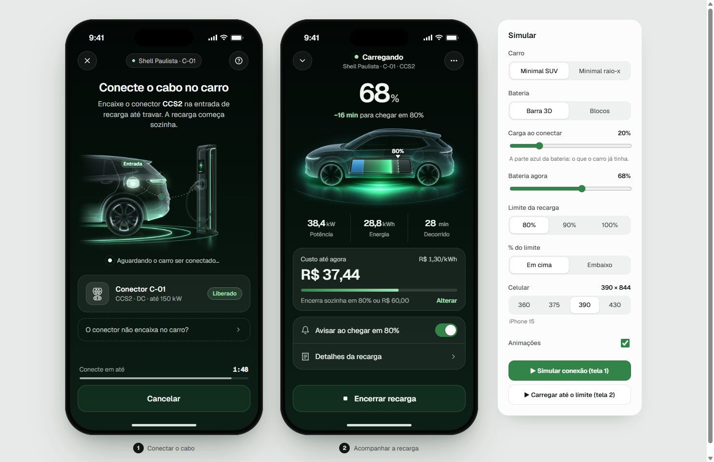

# Recarga EV · pacote de handoff

Mockup e assets de duas telas do fluxo de recarga em eletroposto do iGreen Mob: **Conectar o cabo** e **Acompanhar a recarga**. São dois carros ilustrados (Minimal SUV e Minimal raio-x) e a bateria desenhada por código, em **Barra 3D** ou **Blocos**.

> **Agente:** a especificação para implementar isto no app está em [`IMPLEMENTACAO.md`](IMPLEMENTACAO.md). Leia antes de escrever código.

## Ver o mockup

Dê dois cliques em `mockup.html` (Chrome, Edge ou Safari). O painel "Simular" à direita troca carro, estilo da bateria, carga ao conectar, bateria atual, limite, posição do % do limite e tamanho do celular. Os botões animam a conexão (tela 1) e a recarga (tela 2). Com internet, a fonte Geist carrega do Google Fonts; sem internet, o navegador usa a fonte do sistema.

## O que tem aqui

| Pasta / arquivo | Conteúdo |
|---|---|
| `mockup.html` | O protótipo interativo. É a referência de visual e comportamento |
| `IMPLEMENTACAO.md` | Especificação para implementar no app: passos, composição, geometria da bateria, dados, responsividade, checklist |
| `assets/web/` | Ilustrações em WebP, 480, 960 e 1440 px (usadas pelo mockup) |
| `assets/png/` | As mesmas em PNG com `@2x` / `@3x`, prontas para React Native, iOS e Android |
| `assets/geometria.json` | Cantos da bateria em cada carro, porta e suporte do carregador |
| `previews/` | Capturas do mockup |
| `referencias/` | As referências visuais da barra de bateria |
| `fontes/` | Originais em alta e o script que gera os assets (`npm i sharp` e `node processar-hd.mjs`) |

## Como pedir ao Claude

Coloque esta pasta dentro do projeto do app e peça, por exemplo:

> Leia `recarga-ev-handoff/IMPLEMENTACAO.md` e implemente as telas "Conectar o cabo" e "Acompanhar a recarga" no nosso app, usando os assets da pasta e o mockup como referência visual. Adapte aos componentes e tokens que o app já tem.
